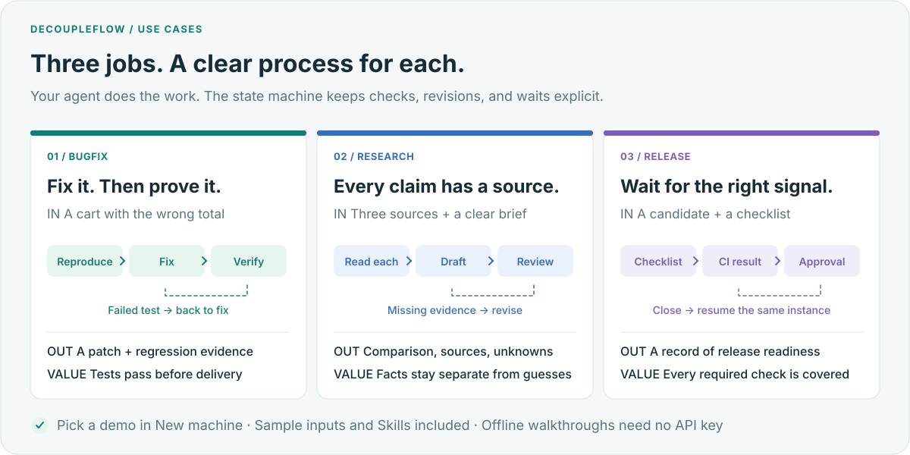
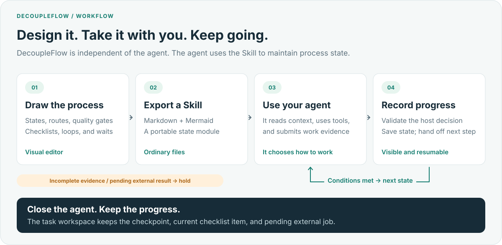
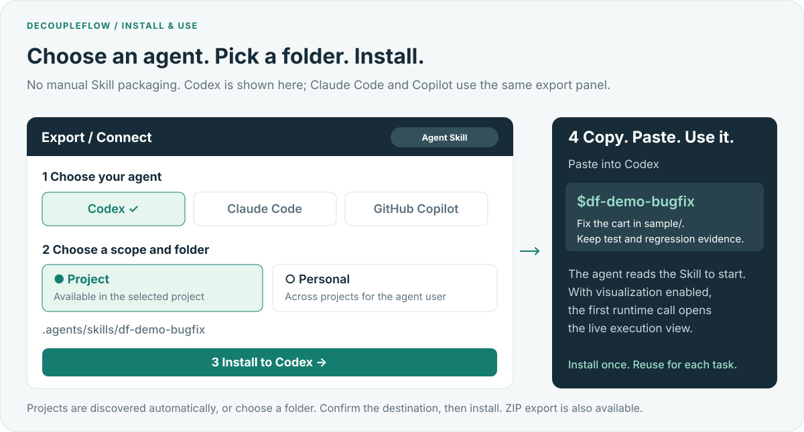

# DecoupleFlow

**Quick Build Long Run**

DecoupleFlow brings **lightweight soft orchestration** to your existing agents. Its independent **visual state-machine editor** turns states, transition conditions, and quality gates into readable Markdown and portable Skills for Codex, Claude Code, or your own harness.

You define what needs to happen and when the process can move forward. Your agent decides how to do the work, chooses its tools, and carries context between steps. The Skill validates the agent's transition decisions and saves progress so long-running tasks can continue across sessions.

- **Guide the process:** define states, shared checklist conditions, branches, loops, and waits while preserving the agent's choice of execution method.
- **Take it with you:** Markdown + Mermaid, Agent Skills, LangGraph, or Dify exports.
- **Pick up where you stopped:** file-backed instances, evidence checks, and a live execution view.

> Like giving an AI a senior teammate's working notes: a clear process, with room to decide how to carry it out.

[Quick start](#quick-start) · [Try three demos](#try-three-demos) · [Codex close/resume example](examples/codex-resume/) · [Tested integrations](examples/verified/) · [MIT](LICENSE) · [简体中文](README.zh-CN.md)


*A 45-second recording of the real interface and exported Skill runtime, using example task data. [Still screenshots and capture details](docs/media.md).*

## Try three demos

Choose one of the first three cards in **New machine**. Each includes sample inputs, a ready-to-import definition, and Skills for Codex, Claude Code, and Copilot.



| Demo | Start with → finish with | Try it |
|---|---|---|
| **Fix a bug, prove it** | A cart total of **17 instead of 42** → a focused patch and three passing regressions | [Guide](examples/demos/bugfix/) · [Project JSON](examples/demos/bugfix/project.en.decoupleflow.json) · [Codex Skill](examples/demos/bugfix/codex.en.zip) |
| **A brief with sources** | Three supplied documents → a comparison with citations and explicit unknowns | [Guide](examples/demos/research/) · [Project JSON](examples/demos/research/project.en.decoupleflow.json) · [Codex Skill](examples/demos/research/codex.en.zip) |
| **Release readiness** | Four checks, a CI job, and approval → a record tied to the correct candidate | [Guide](examples/demos/release/) · [Project JSON](examples/demos/release/project.en.decoupleflow.json) · [Codex Skill](examples/demos/release/codex.en.zip) |

After [setup](#quick-start), prepare a fresh workspace with the sample inputs and an installed Skill:

```bash
npm run demo -- bugfix --prepare
# Open the printed workspace in your agent and paste TASK.txt.
# Substitute research or release; add --agent claude or --agent copilot.
```

To see all three paths without an API key, run `npm run demo -- all`. These local walkthroughs exercise the actual exported Skills with deterministic host decisions. The cart tests really run; the research products, CI results, and reviewer approvals are labeled fixtures. [Demo guide and recorded results](examples/demos/).

## Why DecoupleFlow?

Most workflow tools couple process logic to variables, schemas, and platform-specific nodes. That works well for deterministic automation, but it becomes cumbersome when an agent already knows how to read context, use tools, and produce a result.

DecoupleFlow separates the two concerns:

- **The harness owns execution and data.** It runs models, calls tools, and keeps task context.
- **DecoupleFlow owns process state.** It defines states, transitions, quality gates, waiting, retries, fallbacks, and completion.

A single canonical definition can be:

- run as a lightweight, file-backed state machine;
- installed as a Skill for Codex, Claude Code, or GitHub Copilot;
- exported as readable Markdown with a Mermaid state diagram;
- exported as a LangGraph project;
- imported into Dify as a strict single-step transition workflow;
- observed in a live execution window.

**Soft orchestration** means **weakly constrained execution with explicit transition rules**. You specify the work and the conditions for moving on; the agent chooses its approach and submits its decision. Context and business data stay with the host, so later states can use earlier results without requiring field-by-field data mappings. The Skill checks submitted decisions against the state rules and records accepted transitions.

## How it works



Each state describes the work and its policy. Each transition describes the evidence required to leave that state. DecoupleFlow validates the decision, records the transition, and returns the next handoff. Natural-language judgment can come from the host agent or an optional decision provider such as Jev.

Business payloads are not wired between nodes. They stay in the host's context and are submitted as evidence when a transition is evaluated.

## Current status

DecoupleFlow is a local-first **developer preview**. The core editor, compiler, portable runtime, live observer, Skill exporter, Jev adapter, and LangGraph/Dify exporters are implemented. APIs and exported formats may still change before a stable release.

## Quick start

Requirements:

- Node.js 20 or newer (Node.js 22 LTS recommended)
- npm

```bash
git clone https://github.com/Silicontoy/DecoupleFlow.git
cd DecoupleFlow
npm ci
npm run dev
```

Open [http://localhost:4173](http://localhost:4173). The first launch includes an editable analysis-and-review example.

The language selector below the sidebar brand offers **En** (English, default) and **中** (中文). Your choice is saved in this browser and applies to the interface, generated Markdown and Skill instructions, LangGraph/Dify export guidance, and the exported live window. Preview, ZIP download, and direct installation use the same language. Existing state names, conditions, evidence, and project JSON remain as authored; newly created examples use the selected language.

The export dialog has four routes: **Agent Skill**, **LangChain / LangGraph**, **Dify**, and **Markdown**. The Markdown route lets you preview, copy, or download the complete state-machine document. **Copy Mermaid** copies the entire state diagram inside a `mermaid` code fence, ready to paste into Markdown.

For a production build:

```bash
npm run build
npm start
```

Both modes listen on `127.0.0.1` only. The local service hosts the editor, installation endpoints, optional Jev calls, and the in-editor event stream. It does not execute business tasks for the agent.

## Core model

A DecoupleFlow definition contains:

- **States** — task, ordered list, decision, loop, wait, end, and nested subflow states.
- **Transitions** — source, target, natural-language condition, required quality checks, and uncertainty policy.
- **Quality gates** — checks that a specific transition must pass. Different success and fallback paths may require different checks.
- **Strategies** — what to do while working, on failure, and when evidence is insufficient.
- **Tool guidance and configuration** — instructions for the host, not hard-wired tool bindings.
- **Driver settings** — the host agent by default, or an optional decision provider.

The runtime keeps a version-bound record containing the current state, nested state path, revision, external-wait metadata, and an append-only transition history. Invalid, stale, or insufficient decisions do not change the state.

## Features

### Visual state-machine editor


- Add, drag, connect, duplicate, and delete states.
- Add a **List** state to edit and reorder items with one shared pass condition. Each item must pass that condition and the state’s required quality checks before the next starts. Exit paths become available only after all items pass. Resume keeps the current item; reentering the state starts a new pass through the list. The runtime, live display, Markdown, Skills, LangGraph, and Dify all preserve this behavior.
- Connected ports stay fixed while dragging and after saving or reloading. Port positions are stored with the project layout and do not change the semantic definition.
- Edit multiple decision inputs and outputs without merging routes that share a target.
- Model explicit loop-continue and loop-exit paths.
- Nest, collapse, enter, and return from subflows.
- Validate entries, references, reachability, quality bindings, loop structure, and cross-level transitions.
- Undo and redo edits, manage multiple machines, and import/export project JSON.
- Compile deterministically to Markdown, tagged instructions, Mermaid, and Skill files.

### Portable runtime

- Start, resume, inspect, fork, and archive task instances.
- Bind each instance to the exact semantic definition hash that created it.
- Reject stale revisions and deduplicate external events with `eventId`.
- Hold state when conditions, quality checks, target-entry conditions, or evidence are missing.
- Preserve nested state paths and explicit `__enter__`, `__return__`, and `__finish__` control transitions.
- Keep business execution outside the runtime.

### Live execution view


The observer displays the actual state record and event stream:

- active, visited, retry, waiting, human-review, failed, timed-out, and unvisited states;
- the chosen route, failed checks, probability, and confidence when available;
- pause, continue, single-step, event injection, and checkpoint forking;
- a timestamped event timeline.

The view is an observer, not the source of truth. Forking copies the last committed checkpoint; it does not pretend to roll back external side effects.

### Optional Jev decision provider

The default driver is your own agent. The first maintained adapter integrates TypeSafe AI's Jev as an optional provider for fast structured transition decisions.

The adapter sends the current state, candidate routes, recent transition history, and the evidence supplied by the host. It uses:

- `Choice` to select a candidate transition or stay in place;
- `Noul` checks for the route condition, required quality gates, and target-entry condition;
- configurable confidence and probability thresholds.

Configure `TYPESAFE_API_KEY` in the service or exported runtime environment. Keys are never written into project definitions, task records, browser storage, or export bundles.

Jev judges process transitions; it does not perform the node's business work. DecoupleFlow remains usable without Jev.

## Use it inside an Agent



1. Open **Export / Connect → Agent Skill** and select **Codex**, **Claude Code**, or **GitHub Copilot**.
2. Choose **Project** for one project or **Personal** for use across projects. Existing agent projects are discovered automatically; select the destination or enter it yourself.
3. Click **Install to agent**, then **Copy command**. Paste the command and your task into that agent. For the demos, the preparation command above also supplies the input files and a complete `TASK.txt`.

The one-click action installs the Skill after you choose the destination. With visualization enabled, the agent's first runtime invocation opens the live execution window. The diagram illustrates the interaction; exact labels follow the selected interface language.

### Export a Skill

DecoupleFlow produces a self-contained Skill directory:

```text
df-<machine-id>/
├── SKILL.md
├── README.md
├── decoupleflow-manifest.json
├── references/
│   ├── execution.md
│   ├── state-machine.md
│   ├── state-machine.json
│   └── state-machine.xml
├── scripts/
│   ├── run.mjs
│   ├── monitor.mjs
│   └── adapter.mjs
└── assets/
    ├── execution.html
    └── state-record.template.json
```

The exported Skill runs without the DecoupleFlow editor.

| Host | Project directory | Personal directory | Invocation |
|---|---|---|---|
| Codex | `.agents/skills/` | `~/.agents/skills/` | `$df-<machine-id>` |
| Claude Code | `.claude/skills/` | `~/.claude/skills/` | `/df-<machine-id>` |
| GitHub Copilot | `.github/skills/` | `~/.copilot/skills/` | Ask Copilot to use the Skill |

The editor can download a correctly prefixed ZIP or install directly into an explicitly selected local directory. It detects existing managed installs, creates a backup before an update, and refuses to overwrite a modified or unmanaged Skill.

### Run an exported Skill

From the exported Skill directory:

```bash
node scripts/run.mjs start \
  --workspace /absolute/path/to/task-workspace \
  --actor "Claude Code"
```

This creates a new file-backed instance under:

```text
<task-workspace>/.decoupleflow/<machine-id>/<instance-id>/
```

The returned handoff contains the current state, candidate transitions, required checks, and the decision format expected from the host. Submit actual events and decisions with:

```bash
node scripts/run.mjs event \
  --instance /absolute/path/to/instance \
  --event /absolute/path/to/event.json

node scripts/run.mjs advance \
  --instance /absolute/path/to/instance \
  --decision /absolute/path/to/decision.json \
  --context /absolute/path/to/evidence.txt
```

In Jev mode, omit `--decision` and provide `TYPESAFE_API_KEY`.

Additional lifecycle commands:

| Purpose | Command |
|---|---|
| Resume an unfinished task | `resume --instance <instance>` |
| Open an active or archived record | `view --instance <instance>` |
| List workspace history | `list --workspace <workspace>` |
| Archive an unfinished task | `archive --instance <instance>` |
| Fork from the current checkpoint | `fork --instance <instance>` |

When visualization is enabled, the runner starts a local read-only execution window and returns its URL. Task history remains on disk after the viewer exits.

## Other export targets


| Target | Output | Semantics |
|---|---|---|
| Markdown | One readable SOP with a complete Mermaid graph | Best for agent context, review, and version control |
| Agent Skill | Portable Skill directory or ZIP | Host performs work and maintains a file-backed instance |
| LangGraph | Standalone JavaScript `StateGraph` project | Bind handlers to states; supports checkpoints, interrupts, loops, and subflow returns |
| Dify | Importable `workflow.yml` plus definition files | A strict single-step transition workflow; the host repeatedly supplies the record and new evidence |

The Dify export intentionally does not expand arbitrary business work into native Dify nodes. It embeds the complete state machine in a transition workflow so loops and nested state semantics remain intact. You still bind the business LLM, tools, and repeated calls in Dify or your host service.

Generated examples are available in [`examples/`](examples/), including:

- [`loop-and-routing.md`](examples/loop-and-routing.md)
- [`loop-and-routing.decoupleflow.json`](examples/loop-and-routing.decoupleflow.json)
- [`df-loop-and-routing-langgraph/`](examples/df-loop-and-routing-langgraph/)
- [`df-loop-and-routing-dify/`](examples/df-loop-and-routing-dify/)

## External event integration

The editor's execution workbench accepts real host events over its local API and streams updates with SSE. Supported event types are:

- `agent.started`
- `agent.completed`
- `external.waiting`
- `external.completed`
- `human.required`
- `run.failed`
- `run.timeout`

Each editor run receives a scoped event token. External callers submit the current `expectedRevision` and may include an `eventId` for deduplication. The token grants access only to that run's event and snapshot endpoints; it does not grant installation access.

The editor service stores active workbench runs in memory. Exported Skills use file-backed records in the task workspace and remain independent of the editor.

## What DecoupleFlow does not do

- It does not replace an agent, model, or harness.
- It does not infer business tool bindings from prose.
- It does not require node-to-node business variable mapping.
- It does not expose or store private chain-of-thought.
- It does not roll back external side effects when a task is forked.
- It does not currently provide remote collaboration, cloud sync, AI-generated node decomposition, or a model arena.

## Local data and security boundaries

- The server listens on loopback only and rejects cross-origin API requests.
- Project drafts are stored in the current browser's `localStorage`.
- Project JSON is the portable backup format; clearing site data removes unsaved local drafts.
- Temporary Jev keys entered in the UI stay in panel memory and are not exported.
- Installation is restricted to an explicitly selected project or personal Skill directory.
- A definition supports up to 250 states and 1,000 transitions; installation and import requests are limited to 2 MB.

Optional environment variables:

| Variable | Purpose | Default |
|---|---|---|
| `TYPESAFE_API_KEY` | Optional Jev API key | unset |
| `PORT` | Local HTTP port | `4173` |
| `DECOUPLEFLOW_USER_HOME` | Default personal Skill installation home | Node process home |

## Development

```bash
npm run check       # TypeScript validation
npm test            # Runtime, compiler, adapter, installer, server, and export tests
npm run build       # Type-check and create a production build
npx playwright install chromium
npm run test:e2e    # Browser editing, execution, export, and installation flows
npm run example     # Regenerate portable examples
npm run example:codex -- start   # Real Codex process; stops at a checkpoint
npm run example:codex -- resume  # New process, same session and Skill instance
npm run example:verify -- dify   # Execute the actual exported Dify Code node locally
```

Tests install Skills only into temporary directories.

[GitHub Actions](.github/workflows/ci.yml) runs type checking, all unit tests, a production build, the high/critical audit gate, integration examples, and browser E2E tests. The workflow expects this directory to be the repository root. Live Codex/Jev/Dify calls are opt-in and are not run with personal credentials in CI. See the dated [release verification](docs/release-verification.md) for results and remaining integration requirements.

Repository layout:

```text
src/domain/       Canonical model, validation, runtime, compiler, and exporters
src/editor/       Canvas, browser persistence, and edit history
src/components/   Inspector, execution workbench, export UI, and file previews
server/           Local API, Jev proxy, live runs, discovery, and safe installer
tests/            Unit, integration, and browser tests
examples/         Importable definitions and generated portable artifacts
```

The canonical definition and runtime semantics are the product boundary. The editor, decision providers, Skills, and workflow exporters are adapters around that boundary.

## License

[MIT](LICENSE).
