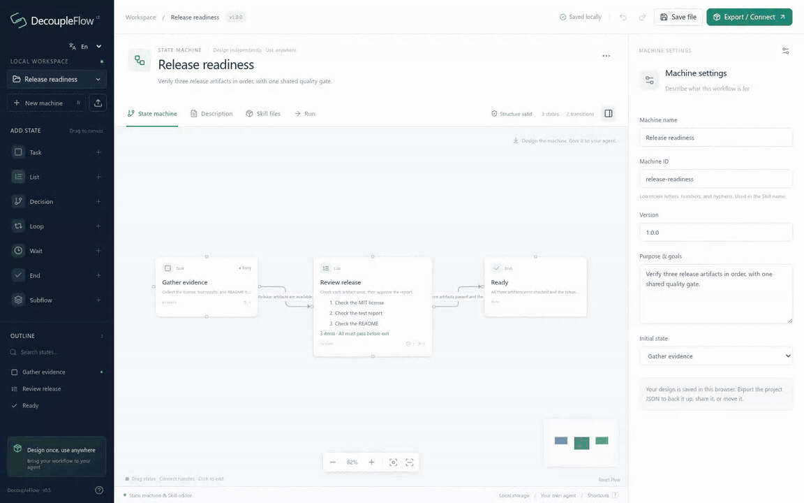
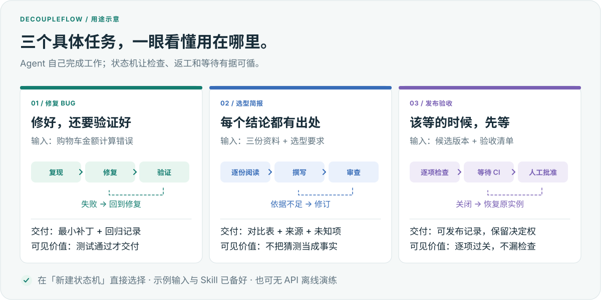
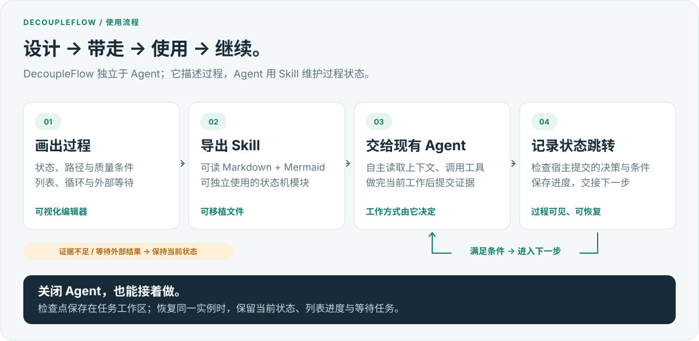
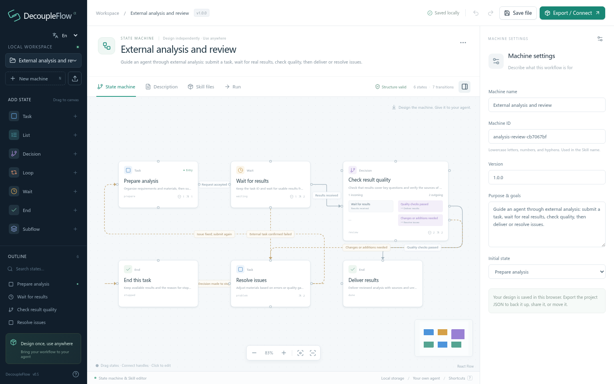
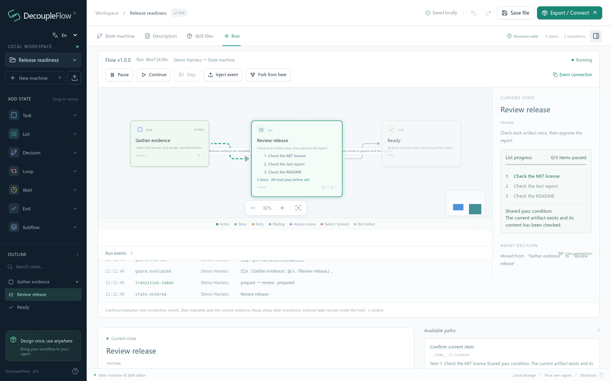
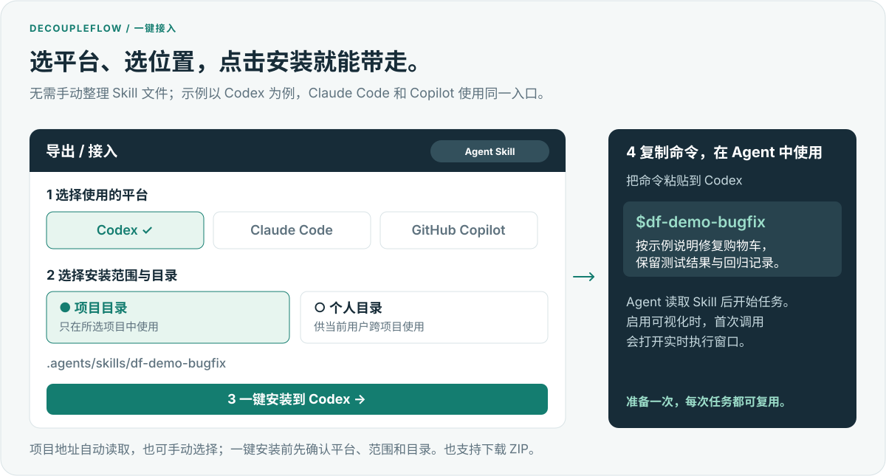
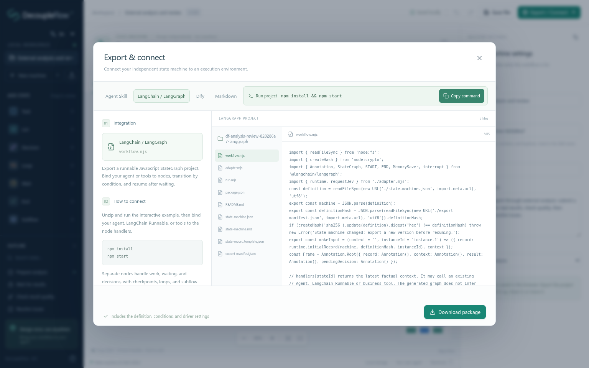

# DecoupleFlow

**Quick Build Long Run**

DecoupleFlow 为你已有的 Agent 提供**轻量级弱编排（Soft Orchestration）**。通过独立的**可视化状态机编辑器**，将状态、跳转条件和质量条件写成可读的 Markdown，导出为 Codex、Claude Code 或自己的 Harness 可以使用的 Skill。

你定义“要做什么、满足什么条件才能进入下一步”；Agent 自主决定具体做法、选择工具，并沿用任务上下文。Skill 校验 Agent 提交的状态跳转并保存进度，让长任务可以跨会话持续推进。

- **轻量引导：** 用状态、列表通过条件、分支、循环与等待描述过程，保留 Agent 对具体执行方式的选择。
- **自由带走：** 导出 Markdown + Mermaid、Agent Skill、LangGraph 或 Dify。
- **关闭后继续：** 实例落盘、证据校验，实时查看状态与跳转。

> 像让 AI 对着学长的笔记自己做：过程清晰，具体做法由 Agent 判断。

[快速开始](#快速开始) · [三个场景演示](#三个场景演示) · [Codex 关闭与恢复示例](examples/codex-resume/) · [集成实测](examples/verified/) · [MIT](LICENSE) · [English](README.md)



*45 秒真实界面与导出 Skill 运行录像，使用示例任务数据。[静态截图与录制说明](docs/media.md)。*

## 三个场景演示

在**新建状态机**中直接选择前三张 Demo 卡片。每个都附示例输入、可导入定义，以及 Codex、Claude Code、Copilot 的 Skill 包。



| Demo | 从什么开始 → 得到什么 | 直接体验 |
|---|---|---|
| **修复 Bug 并验证** | 购物车应为 **42 却算成 17** → 最小补丁与三个通过的回归用例 | [说明](examples/demos/bugfix/README.zh-CN.md) · [项目 JSON](examples/demos/bugfix/project.zh.decoupleflow.json) · [Codex Skill](examples/demos/bugfix/codex.zh.zip) |
| **带来源的选型简报** | 三份给定资料 → 有引用、标明未知项的对比与建议 | [说明](examples/demos/research/README.zh-CN.md) · [项目 JSON](examples/demos/research/project.zh.decoupleflow.json) · [Codex Skill](examples/demos/research/codex.zh.zip) |
| **发布前逐项验收** | 四项检查、CI 任务、人工批准 → 对应正确候选版本的可发布记录 | [说明](examples/demos/release/README.zh-CN.md) · [项目 JSON](examples/demos/release/project.zh.decoupleflow.json) · [Codex Skill](examples/demos/release/codex.zh.zip) |

完成[安装](#快速开始)后，一条命令准备独立目录，放好示例输入并安装 Skill：

```bash
npm run demo -- bugfix --prepare --language zh
# 在 Agent 中打开打印的目录，粘贴 TASK.txt。
# 换成 research 或 release 即可体验其他场景；支持 --agent claude / copilot。
```

先不接模型也能看效果：运行 `npm run demo -- all --language zh`，用确定性的宿主操作走完真实导出的 Skill。购物车测试会实际执行；选型产品、CI 结果、人工批准均为标记清楚的示例数据。[完整体验说明与演练记录](examples/demos/README.zh-CN.md)。

## 为什么需要 DecoupleFlow？

传统工作流通常把过程逻辑、变量、数据结构和平台节点绑定在一起。这种方式适合确定性的自动化，但当 Agent 本身已经能够理解上下文、调用工具和完成任务时，逐个映射变量往往会成为额外负担。

DecoupleFlow 将两件事解耦：

- **Harness 负责执行和数据。** 运行模型、调用工具，并维护任务上下文。
- **DecoupleFlow 负责过程状态。** 定义状态、跳转、质量门、等待、重试、兜底和结束。

同一份规范定义可以：

- 作为轻量级、文件持久化的状态机运行；
- 安装为 Codex、Claude Code 或 GitHub Copilot Skill；
- 导出为带完整 Mermaid 状态图的 Markdown；
- 导出为 LangGraph 工程；
- 导入 Dify，作为严格的单步状态迁移工作流；
- 在独立窗口中实时观察运行过程。

这里的 **Soft Orchestration** 指的是**执行方式弱约束，状态跳转有明确规则**。你定义任务和进入下一步的条件，Agent 自主选择做法并提交判断。上下文与业务数据留在宿主中，后续状态可沿用已有结果，无需逐字段配置数据映射。Skill 按状态规则校验提交的判断，记录通过的跳转。

## 工作原理



状态描述当前应该做什么以及处理策略；迁移描述离开当前状态所需的实际证据。DecoupleFlow 校验决策、记录迁移，并返回下一个交接包。自然语言判断可以由宿主 Agent 完成，也可以交给 Jev 之类的可选决策模型。

节点之间不需要配置业务字段连线。业务数据留在宿主上下文中，只在判断迁移时作为证据提交。

## 当前状态

DecoupleFlow 目前是本地优先的 **Developer Preview**。状态机编辑器、编译器、可移植运行时、实时观察器、Skill 导出、Jev Adapter，以及 LangGraph 和 Dify 导出均已实现。稳定版之前，API 和导出格式仍可能调整。

## 快速开始

环境要求：

- Node.js 20 或更高版本（推荐 Node.js 22 LTS）
- npm

```bash
git clone https://github.com/Silicontoy/DecoupleFlow.git
cd DecoupleFlow
npm ci
npm run dev
```

打开 [http://localhost:4173](http://localhost:4173)。首次启动会显示一份可以直接编辑的“外部分析与评审”示例。

左侧品牌下方的语言选择器提供 **En（英文，默认）** 与 **中（中文）**，浏览器会记住选择。界面、系统生成的 Markdown 和 Skill 说明、LangGraph / Dify 接入说明以及导出的实时执行窗口同步使用所选语言；预览、下载 ZIP 和直接安装保持一致。已有状态名称、条件、证据与项目 JSON 保持原文，新建示例使用当前语言。

导出弹窗提供 **Agent Skill**、**LangChain / LangGraph**、**Dify** 和 **Markdown** 四条路线。Markdown 页可以预览、复制或下载完整状态机文档；**复制 Mermaid** 会一并复制整个状态机图及其 `mermaid` 代码围栏，可直接粘贴到 Markdown 中。

生产模式：

```bash
npm run build
npm start
```

两种模式都只监听 `127.0.0.1`。本地服务提供编辑器、安装接口、可选 Jev 调用和编辑器内事件流，但不会替 Agent 执行业务任务。

## 核心模型

一份 DecoupleFlow 定义包含：

- **状态**：工作、列表、条件判断、循环、等待、结束和嵌套子状态机。
- **跳转**：来源、目标、自然语言条件、必要质量项和不确定时的策略。
- **质量门**：某一条具体路径必须通过的检查。成功路径和失败路径可以引用不同的质量项。
- **处理策略**：执行期间、失败时和证据不足时应该如何处理。
- **工具说明与配置**：提供给宿主的指引，而不是硬编码的工具绑定。
- **推进方式**：默认由宿主 Agent 判断，也可以接入独立决策模型。

运行时记录当前状态、嵌套状态路径、版本号、外部等待信息和只追加的迁移历史，并绑定创建实例时的语义定义哈希。非法、过期或证据不足的决策不会改变状态。

## 主要能力

### 可视化状态机编辑器



- 添加、拖动、连接、复制和删除状态。
- 添加**列表**状态，编辑、排序事项并填写统一通过条件。每项通过同一条件和本状态的必要质量项后，才处理下一项；全部通过后才能检查出口。暂停恢复保留当前项，重新进入状态从第一项开始。运行时、实时展示、Markdown、Skill、LangGraph 和 Dify 均保留这些规则。
- 拖动状态时保持连接点固定，保存和重新打开也不会改变连接方向。连接点位置随项目布局保存，不影响状态机定义和运行实例。
- 为条件节点编辑多条入路和出路；即使多个条件指向同一目标，也不会合并路径。
- 显式表达循环的继续和退出路径。
- 嵌套、折叠、进入和返回子状态机。
- 检查入口、引用、可达性、质量项绑定、循环结构和跨层跳转。
- 支持撤销、重做、多状态机管理，以及项目 JSON 导入导出。
- 确定性编译为 Markdown、标签描述、Mermaid 和 Skill 文件。

### 可移植运行时

- 创建、恢复、查看、分叉和归档任务实例。
- 每个实例固定绑定创建它的语义定义版本。
- 拒绝过期 revision，并通过 `eventId` 对外部事件去重。
- 条件、质量项、目标进入条件或证据缺失时保持当前状态。
- 保留嵌套状态路径，以及显式的 `__enter__`、`__return__`、`__finish__` 控制迁移。
- 业务执行始终留在运行时之外。

### 实时执行可视化



观察器展示真实状态记录和事件流：

- 当前、已完成、返工、等待、人工检查、失败、超时和未执行状态；
- 实际选择的路径、未通过检查，以及可用时的概率和置信度；
- 暂停、继续、单步、事件注入和从检查点分叉；
- 带时间戳的运行事件记录。

可视化界面只是观察器，不是事实来源。分叉复制的是最近一次已提交检查点，不会假装回滚已经发生的外部副作用。

### 可选 Jev 决策模型

默认推进方式是你自己的 Agent。首个由 DecoupleFlow 维护的 Adapter 可将 TypeSafe AI 的 Jev 作为快速、结构化的状态判断器。

Adapter 会提交当前状态、候选路径、最近迁移历史和宿主提供的本次证据，并使用：

- `Choice` 选择候选迁移或保持当前状态；
- `Noul` 分别检查路径条件、必要质量项和目标进入条件；
- 可配置的置信度与概率阈值。

在服务或导出的运行环境中配置 `TYPESAFE_API_KEY`。Key 不会写入项目定义、任务记录、浏览器存储或导出包。

Jev 只判断状态迁移，不完成节点内的业务工作。没有 Jev 时，DecoupleFlow 仍可完整使用。

## 在 Agent 中使用



1. 打开**导出 / 接入 → Agent Skill**，选择 **Codex**、**Claude Code** 或 **GitHub Copilot**。
2. 单项目使用选**指定项目**，跨项目复用选**个人目录**。界面会自动读取已有 Agent 项目，选择目标地址，也可自行填写。
3. 点击**安装到 Agent**，再点**复制命令**，将命令和任务一起粘贴给 Agent。上方 Demo 的准备命令还会放好输入文件，并生成可以直接粘贴的 `TASK.txt`。

“一键”指选好位置后直接完成 Skill 安装。开启可视化时，Agent 第一次调用运行助手就会打开实时执行窗口。图中为操作示意，具体按钮文字随界面语言切换。

### 导出 Skill

DecoupleFlow 会生成一份自包含的 Skill：

```text
df-<状态机标识>/
├── SKILL.md
├── README.md
├── decoupleflow-manifest.json
├── references/
│   ├── execution.md
│   ├── state-machine.md
│   ├── state-machine.json
│   └── state-machine.xml
├── scripts/
│   ├── run.mjs
│   ├── monitor.mjs
│   └── adapter.mjs
└── assets/
    ├── execution.html
    └── state-record.template.json
```

导出的 Skill 不依赖 DecoupleFlow 编辑器运行。

| 宿主 | 项目目录 | 个人目录 | 调用方式 |
|---|---|---|---|
| Codex | `.agents/skills/` | `~/.agents/skills/` | `$df-<状态机标识>` |
| Claude Code | `.claude/skills/` | `~/.claude/skills/` | `/df-<状态机标识>` |
| GitHub Copilot | `.github/skills/` | `~/.copilot/skills/` | 请求 Copilot 使用该 Skill |

编辑器可以下载带正确目录前缀的 ZIP，也可以安装到用户明确选择的本地目录。安装器会识别已有托管版本、更新前创建备份，并拒绝覆盖被手工修改或不属于 DecoupleFlow 的同名 Skill。

### 运行导出的 Skill

在导出的 Skill 目录执行：

```bash
node scripts/run.mjs start \
  --workspace /任务工作区的绝对路径 \
  --actor "Claude Code"
```

每次启动都会在任务工作区创建一个文件持久化实例：

```text
<任务工作区>/.decoupleflow/<状态机标识>/<实例 ID>/
```

返回的交接包包含当前状态、候选迁移、必要检查项，以及宿主需要提供的决策格式。提交真实事件和决策：

```bash
node scripts/run.mjs event \
  --instance /实例的绝对路径 \
  --event /事件文件的绝对路径

node scripts/run.mjs advance \
  --instance /实例的绝对路径 \
  --decision /决策文件的绝对路径 \
  --context /证据文件的绝对路径
```

使用 Jev 时省略 `--decision`，并提供 `TYPESAFE_API_KEY`。

其他生命周期命令：

| 目的 | 命令 |
|---|---|
| 恢复未完成任务 | `resume --instance <实例>` |
| 查看活动或归档记录 | `view --instance <实例>` |
| 列出工作区历史 | `list --workspace <工作区>` |
| 归档未完成任务 | `archive --instance <实例>` |
| 从当前位置创建分支 | `fork --instance <实例>` |

开启可视化后，运行助手会启动一个本地只读窗口并返回地址。观察窗口退出后，任务历史仍会保留在磁盘中。

## 其他导出目标



| 目标 | 产物 | 语义 |
|---|---|---|
| Markdown | 一份带完整 Mermaid 状态图的可读 SOP | 适合输入 Agent、人工评审和版本管理 |
| Agent Skill | 可移植 Skill 目录或 ZIP | 宿主完成工作，并维护文件持久化实例 |
| LangGraph | 独立 JavaScript `StateGraph` 工程 | 将处理器绑定到状态；支持检查点、interrupt、循环和子流程返回 |
| Dify | 可导入的 `workflow.yml` 及定义文件 | 严格的单步迁移工作流；宿主重复提交实例记录和新证据 |

Dify 导出不会把任意业务工作强行展开为 Dify 原生节点。完整状态机被嵌入一个迁移工作流中，从而保留自由回路和嵌套状态语义。业务 LLM、工具和重复调用仍需在 Dify 或宿主服务中绑定。

[`examples/`](examples/) 中包含可直接查看或导入的产物：

- [`loop-and-routing.md`](examples/loop-and-routing.md)
- [`loop-and-routing.decoupleflow.json`](examples/loop-and-routing.decoupleflow.json)
- [`df-loop-and-routing-langgraph/`](examples/df-loop-and-routing-langgraph/)
- [`df-loop-and-routing-dify/`](examples/df-loop-and-routing-dify/)

## 外部事件接入

编辑器内的执行工作台可以通过本地 API 接收真实宿主事件，并使用 SSE 实时更新。支持：

- `agent.started`
- `agent.completed`
- `external.waiting`
- `external.completed`
- `human.required`
- `run.failed`
- `run.timeout`

每个编辑器实例都有独立事件令牌。外部调用方需要提交当前 `expectedRevision`，还可以提供 `eventId` 进行去重。事件令牌只能上报该实例的事件和读取快照，不能调用 Skill 安装接口。

编辑器服务中的活动调试实例保存在内存中。导出的 Skill 使用任务工作区中的文件记录，与编辑器完全独立。

## DecoupleFlow 不做什么

- 不替代 Agent、模型或 Harness。
- 不从自然语言说明中猜测业务工具绑定。
- 不要求为节点配置业务变量映射。
- 不读取或存储模型私有思维链。
- 分叉任务时不假装回滚外部副作用。
- 当前不提供远程协作、云同步、AI 自动拆解节点或模型竞技场。

## 本地数据与安全边界

- 服务只监听本机，并拒绝跨来源 API 请求。
- 项目草稿保存在当前浏览器的 `localStorage`。
- 项目 JSON 是可移植备份格式；清除站点数据会删除尚未导出的草稿。
- 在界面临时填写的 Jev Key 只保留在面板内存中，不会进入导出内容。
- 安装目标必须是用户明确选择的项目或个人 Skill 目录。
- 单份定义最多 250 个状态、1,000 条跳转；安装和导入请求最大 2 MB。

可选环境变量：

| 变量 | 用途 | 默认值 |
|---|---|---|
| `TYPESAFE_API_KEY` | 可选 Jev API Key | 未配置 |
| `PORT` | 本地 HTTP 端口 | `4173` |
| `DECOUPLEFLOW_USER_HOME` | 个人 Skill 安装的默认用户目录 | Node 进程用户目录 |

## 开发与验证

```bash
npm run check       # TypeScript 检查
npm test            # 运行时、编译、Adapter、安装、服务和导出测试
npm run build       # 类型检查与生产构建
npx playwright install chromium
npm run test:e2e    # 浏览器编辑、执行、导出和安装流程
npm run example     # 重新生成可移植示例
npm run example:codex -- start   # 真实 Codex 执行，在检查点退出
npm run example:codex -- resume  # 新进程恢复同一会话与实例
npm run example:verify -- dify   # 本地执行实际导出的 Dify Code 节点
```

测试只会把 Skill 安装到临时目录。

[GitHub Actions](.github/workflows/ci.yml) 包含类型检查、全部单元测试、生产构建、high/critical 依赖审计、集成示例和全部 E2E。工作流以本目录作为仓库根目录。Codex、Jev 和 Dify 的线上调用需显式运行，CI 不使用个人账号凭据。实际结果与尚需配置的集成项见[发布验证记录](docs/release-verification.md)。

项目结构：

```text
src/domain/       规范模型、校验、运行时、编译器和导出器
src/editor/       画布、浏览器持久化和编辑历史
src/components/   属性面板、执行工作台、导出界面和文件预览
server/           本地 API、Jev 代理、活动实例、目录发现和安全安装器
tests/            单元、集成和浏览器测试
examples/         可导入定义与生成的可移植产物
```

规范定义与运行时语义是 DecoupleFlow 的产品边界；编辑器、决策模型、Skill 和工作流导出器，都是围绕这一边界构建的适配层。

## 许可证

采用 [MIT 许可证](LICENSE)。
