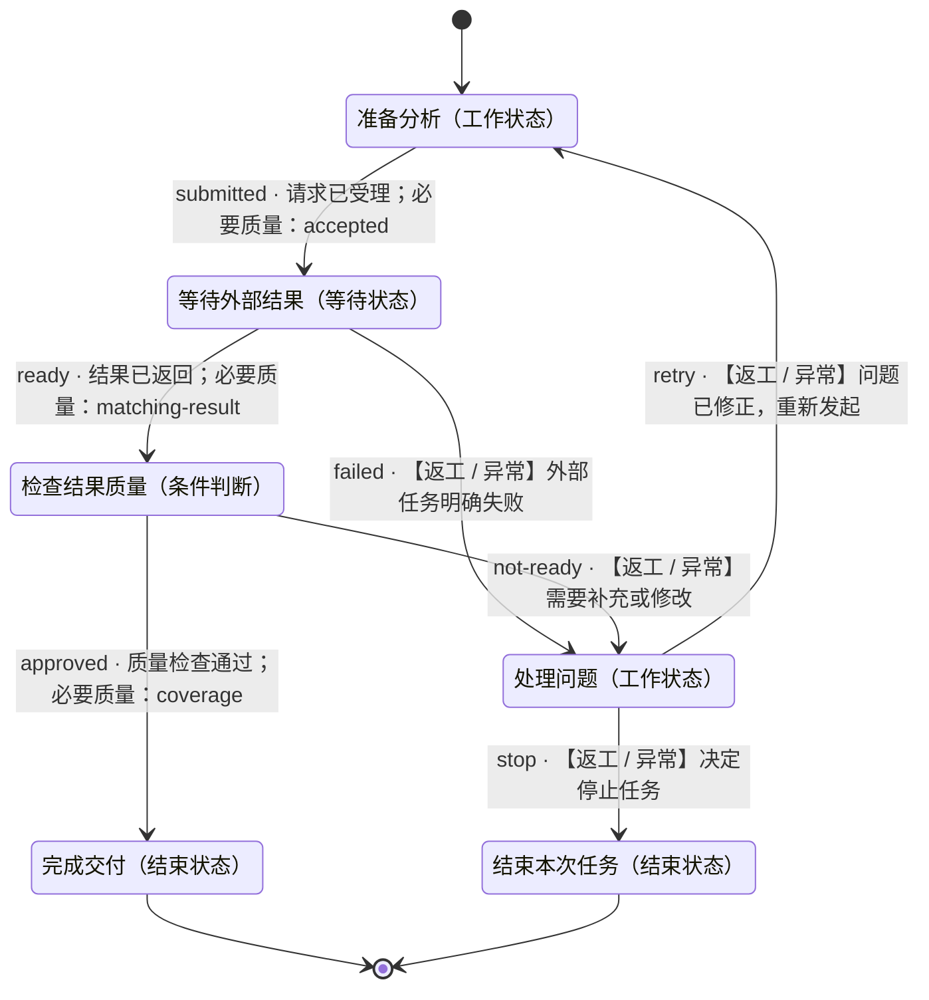

# 外部分析与评审

- 状态机：`analysis-review`
- 定义版本：`1.0.0`
- 入口：准备分析（`prepare`）

## 用途

> 让 Agent 正确处理外部分析任务：提交后等待真实结果，检查质量，再完成交付或处理问题。

## 状态机总览

以下为完整状态机定义。连线标注迁移 ID、跳转条件及必要质量项；返工、异常和循环均保留。子状态机内部结束后返回父层级。

## 推进方式

使用自己的 Agent 读取本定义、检查实际证据并维护状态。无需调用 DecoupleFlow 或其他决策服务。

## 使用约定

由宿主 Agent 使用本状态机。节点内如何完成工作由 Agent 自主决定；条件满足后，依据已定义的迁移更新当前状态。

业务材料和工具由宿主管理。未知条件不等于满足条件；工具请求受理不等于任务完成。仅对迁移显式引用的质量项进行该次跳转的必要检查，其余质量项用于改进结果。

子状态机有独立入口；进入子状态机后从内部入口开始，内部结束状态表示返回父状态机，再检查该子状态机节点的出边。记录完整状态路径，避免混淆不同层级。

## 状态一览

| ID | 状态 | 类型 | 所属层级 |
|---|---|---|---|
| `done` | 完成交付 | 结束状态 | 顶层 |
| `prepare` | 准备分析 | 工作状态 | 顶层 |
| `problem` | 处理问题 | 工作状态 | 顶层 |
| `review` | 检查结果质量 | 条件判断 | 顶层 |
| `stopped` | 结束本次任务 | 结束状态 | 顶层 |
| `waiting` | 等待外部结果 | 等待状态 | 顶层 |

## 跳转一览

| 跳转 ID | 从 | 到 | 条件 | 路径类型 | 必要质量项 |
|---|---|---|---|---|---|
| `approved` | 检查结果质量 | 完成交付 | 质量检查通过 | 正常 | `coverage` |
| `failed` | 等待外部结果 | 处理问题 | 外部任务明确失败 | 返工 / 异常 | — |
| `not-ready` | 检查结果质量 | 处理问题 | 需要补充或修改 | 返工 / 异常 | — |
| `ready` | 等待外部结果 | 检查结果质量 | 结果已返回 | 正常 | `matching-result` |
| `retry` | 处理问题 | 准备分析 | 问题已修正，重新发起 | 返工 / 异常 | — |
| `stop` | 处理问题 | 结束本次任务 | 决定停止任务 | 返工 / 异常 | — |
| `submitted` | 准备分析 | 等待外部结果 | 请求已受理 | 正常 | `accepted` |

## 完成交付 · done

类型：结束状态

### 状态说明

> 交付已检查的分析结果，并附来源和未解决事项。

### 进入条件

_未填写_

### 质量条件

未单独定义。

结束结果：success。结束当前任务实例。

### 工具调用说明

_未填写_

### 配置说明

_未填写_

### 当前状态的处理策略

_未填写_

### 失败时的处理

_未填写_

### 无法判断时

> 无法判断时保留当前状态，补充信息后再次检查。

### 下个步骤

这是结束状态。

## 准备分析 · prepare

类型：工作状态

### 状态说明

> 整理需求与材料，向宿主已有的分析工具提交任务。

### 进入条件

> 已明确本次分析目标，且已有可使用的材料。

### 质量条件

- `accepted` · 迁移检查项：请求已受理，并取得外部任务标识。

### 工具调用说明

> 使用宿主已有的外部分析工具。确认受理后记录任务 ID，避免重复提交。

### 配置说明

_未填写_

### 当前状态的处理策略

> 确认材料和目标，再组织工具参数。

### 失败时的处理

> 先查看提交结果，确认未受理后再考虑重试。

### 无法判断时

> 无法确认提交结果时先查询，不重复提交。

### 下个步骤

- **等待外部结果**（`waiting`），迁移 `submitted`
  - 条件：请求已受理
  - 路径类型：正常
  - 必要质量项：accepted
  - 不确定时：保留当前状态，核实条件后再决定。

## 处理问题 · problem

类型：工作状态

### 状态说明

> 根据错误或质量缺口调整材料，决定重新发起或停止。

### 进入条件

_未填写_

### 质量条件

未单独定义。

### 工具调用说明

_未填写_

### 配置说明

_未填写_

### 当前状态的处理策略

> 先确认问题来源。重新发起前确认旧任务已结束或不会重复产生副作用。

### 失败时的处理

> 说明无法解决的原因，询问用户是否停止。

### 无法判断时

> 保留问题记录，补充信息后决定。

### 下个步骤

- **准备分析**（`prepare`），迁移 `retry`
  - 条件：问题已修正，重新发起
  - 路径类型：返工 / 异常
  - 必要质量项：无额外引用
  - 不确定时：保留当前状态，核实条件后再决定。

- **结束本次任务**（`stopped`），迁移 `stop`
  - 条件：决定停止任务
  - 路径类型：返工 / 异常
  - 必要质量项：无额外引用
  - 不确定时：保留当前状态，核实条件后再决定。

## 检查结果质量 · review

类型：条件判断

### 状态说明

> 检查分析结果是否覆盖关键问题，并核对结论来源。

### 进入条件

_未填写_

### 质量条件

- `coverage` · 迁移检查项：关键问题均有回答，结论能关联到来源。

- `clarity` · 改进建议：清楚标明尚未解决的问题。

### 进入路径

任一入路满足条件后可以到达此节点；每次到达后重新判断出路。

- 来自 **等待外部结果**，迁移 `ready`：结果已返回

### 分支选择策略

> 每次从任一入路到达后，结合当前上下文检查各出路的条件、必要质量项与目标进入条件，沿明确满足条件的路径迁移。没有匹配、证据不足或多个条件冲突时保留当前状态，核实后再选择。

### 工具调用说明

_未填写_

### 配置说明

_未填写_

### 当前状态的处理策略

> 按质量条件逐项检查，给出简要结论和依据。

### 失败时的处理

> 说明具体质量缺口，进入问题处理。

### 无法判断时

> 必要时补充核对，不把未知标记为合格。

### 下个步骤

- **完成交付**（`done`），迁移 `approved`
  - 条件：质量检查通过
  - 路径类型：正常
  - 必要质量项：coverage
  - 不确定时：保留当前状态，核实条件后再决定。

- **处理问题**（`problem`），迁移 `not-ready`
  - 条件：需要补充或修改
  - 路径类型：返工 / 异常
  - 必要质量项：无额外引用
  - 不确定时：保留当前状态，核实条件后再决定。

## 结束本次任务 · stopped

类型：结束状态

### 状态说明

> 保留已有结果与停止原因，结束本次任务。

### 进入条件

_未填写_

### 质量条件

未单独定义。

结束结果：stopped。结束当前任务实例。

### 工具调用说明

_未填写_

### 配置说明

_未填写_

### 当前状态的处理策略

_未填写_

### 失败时的处理

_未填写_

### 无法判断时

> 无法判断时保留当前状态，补充信息后再次检查。

### 下个步骤

这是结束状态。

## 等待外部结果 · waiting

类型：等待状态

### 状态说明

> 保留任务标识，等待原分析任务返回可用结果。

### 进入条件

> 分析请求已被受理，任务 ID 已记录。

### 质量条件

- `matching-result` · 迁移检查项：结果属于当前任务，且内容能够读取。

### 工具调用说明

> 使用宿主的任务查询能力，查询原任务；若宿主支持回调，可使用其事件通知。

### 配置说明

> 建议查询间隔：30 秒。
> 任务关联：沿用原任务 ID。

### 当前状态的处理策略

> 可以整理不依赖分析结果的提纲。宿主无法自动唤醒时，记录待恢复事项。

### 失败时的处理

> 明确失败后进入问题处理；超时本身不表示失败。

### 无法判断时

> 保留等待状态，核实任务进展；不假定已经完成。

### 下个步骤

- **处理问题**（`problem`），迁移 `failed`
  - 条件：外部任务明确失败
  - 路径类型：返工 / 异常
  - 必要质量项：无额外引用
  - 不确定时：保留当前状态，核实条件后再决定。

- **检查结果质量**（`review`），迁移 `ready`
  - 条件：结果已返回
  - 路径类型：正常
  - 必要质量项：matching-result
  - 不确定时：保留当前状态，核实条件后再决定。
