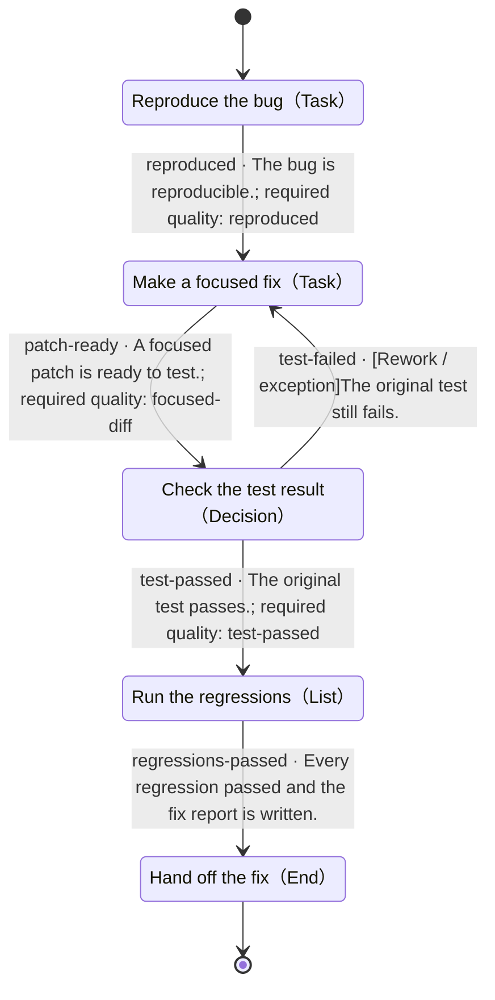

# Fix a bug, prove it

- State machine: `demo-bugfix`
- Definition version: `1.0.0`
- Entry: Reproduce the bug (`reproduce`)

## Purpose

> Fix a cart total that ignores quantity. Deliver a focused patch and a regression report, with actual before/after test results.

## State machine overview

This diagram shows the complete state machine definition. Edges include transition IDs, conditions, and required quality items. Rework, exceptions, and loops are preserved. Internal subflow end states return to their parent level.

## Process driver

Your own agent reads this definition, checks actual evidence, and maintains the state. No DecoupleFlow or decision service is required.

## Usage conventions

The host agent uses this state machine and decides how to perform work within each node. Update the current state along a defined transition only when its conditions are met.

The host manages business materials and tools. An unknown condition is not a satisfied condition; an accepted tool request is not a completed task. Check the quality items explicitly referenced by the chosen transition. Other quality items guide improvements.

Each subflow has its own entry. Start there when entering a subflow. An internal end state returns to its parent, after which the parent node checks its outgoing paths. Record the full state path to distinguish levels.

## States

| ID | State | Type | Parent |
|---|---|---|---|
| `done` | Hand off the fix | End | Top level |
| `fix` | Make a focused fix | Task | Top level |
| `regression` | Run the regressions | List | Top level |
| `reproduce` | Reproduce the bug | Task | Top level |
| `verify` | Check the test result | Decision | Top level |

## Transitions

| Transition ID | From | To | Condition | Path type | Required quality |
|---|---|---|---|---|---|
| `patch-ready` | Make a focused fix | Check the test result | A focused patch is ready to test. | Normal | `focused-diff` |
| `regressions-passed` | Run the regressions | Hand off the fix | Every regression passed and the fix report is written. | Normal | — |
| `reproduced` | Reproduce the bug | Make a focused fix | The bug is reproducible. | Normal | `reproduced` |
| `test-failed` | Check the test result | Make a focused fix | The original test still fails. | Rework / exception | — |
| `test-passed` | Check the test result | Run the regressions | The original test passes. | Normal | `test-passed` |

## Hand off the fix · done

Type: End

### State description

> Deliver the patch and artifacts/fix-report.md with the cause, change, and regression results.

### Entry conditions

_Not specified_

### Quality conditions

None defined.

Outcome: success. End the current task instance.

### Tool guidance

_Not specified_

### Configuration

_Not specified_

### Strategy during this state

> Use the host agent and record concise evidence in the task workspace.

### On failure

> Record the concrete gap; do not mark it as passed.

### When uncertain

> Keep this state and ask for the missing information.

### Next steps

This is an end state.

## Make a focused fix · fix

Type: Task

### State description

> Fix sample/cart.mjs. Preserve the exported function, input shape, and test assertions.

### Entry conditions

_Not specified_

### Quality conditions

- `focused-diff` · Transition check：The patch addresses quantity without unrelated changes.

### Tool guidance

_Not specified_

### Configuration

> Change only the calculation. Do not weaken, skip, or delete tests.

### Strategy during this state

> Use the host agent and record concise evidence in the task workspace.

### On failure

> Record the concrete gap; do not mark it as passed.

### When uncertain

> Keep this state and ask for the missing information.

### Next steps

- **Check the test result** (`verify`), transition `patch-ready`
  - Condition: A focused patch is ready to test.
  - Path type: Normal
  - Required quality: focused-diff
  - When uncertain: Hold this state until the evidence supports this path.

## Run the regressions · regression

Type: List

### State description

> Check the three cases in order. Save a separate test result for each; the exit opens only after all pass.

### Entry conditions

_Not specified_

### Quality conditions

- `case-evidence` · Transition check：The saved output identifies this case and its passing assertion.

### Ordered items

1. `empty` · Empty cart returns zero
2. `single` · One product includes its quantity
3. `multiple` · Multiple products add up correctly

### Shared pass condition

> The current named test actually ran, passed, and has saved output.

Process the list in order. Recheck the shared pass condition and this state’s required quality checks for each item; stay on the current item if it fails or is uncertain. Check exit conditions only after all items pass. Pause and resume preserve the current item; reentering this state starts from the first item.

### Tool guidance

_Not specified_

### Configuration

_Not specified_

### Strategy during this state

> Use the host agent and record concise evidence in the task workspace.

### On failure

> Record the concrete gap; do not mark it as passed.

### When uncertain

> Keep this state and ask for the missing information.

### Next steps

- **Hand off the fix** (`done`), transition `regressions-passed`
  - Condition: Every regression passed and the fix report is written.
  - Path type: Normal
  - Required quality: No additional references
  - When uncertain: Hold this state until the evidence supports this path.

## Reproduce the bug · reproduce

Type: Task

### State description

> Read sample/bug-report.md. Run sample/cart.test.mjs with node --test and save the failing output in artifacts/before.tap.

### Entry conditions

_Not specified_

### Quality conditions

- `reproduced` · Transition check：The supplied quantity example fails with the observed and expected totals recorded.

### Tool guidance

> Run tests in the task workspace. Preserve the failing assertion and its input.

### Configuration

_Not specified_

### Strategy during this state

> Use the host agent and record concise evidence in the task workspace.

### On failure

> Record the concrete gap; do not mark it as passed.

### When uncertain

> Keep this state and ask for the missing information.

### Next steps

- **Make a focused fix** (`fix`), transition `reproduced`
  - Condition: The bug is reproducible.
  - Path type: Normal
  - Required quality: reproduced
  - When uncertain: Hold this state until the evidence supports this path.

## Check the test result · verify

Type: Decision

### State description

> Run the original reproduction again. Select the path using the actual exit code and output.

### Entry conditions

_Not specified_

### Quality conditions

- `test-passed` · Transition check：The original failing case now passes without changing its assertion.

### Incoming paths

Any incoming path whose conditions are satisfied may reach this node. Evaluate outgoing paths on every arrival.

- From **Make a focused fix**, transition `patch-ready`: A focused patch is ready to test.

### Branch selection policy

> On each arrival, use the current context to check outgoing conditions, required quality items, and target entry conditions. Follow a path whose conditions clearly pass. Stay and verify when no path matches, evidence is insufficient, or conditions conflict.

### Tool guidance

_Not specified_

### Configuration

_Not specified_

### Strategy during this state

> Use the host agent and record concise evidence in the task workspace.

### On failure

> Record the concrete gap; do not mark it as passed.

### When uncertain

> Keep this state and ask for the missing information.

### Next steps

- **Make a focused fix** (`fix`), transition `test-failed`
  - Condition: The original test still fails.
  - Path type: Rework / exception
  - Required quality: No additional references
  - When uncertain: Hold this state until the evidence supports this path.

- **Run the regressions** (`regression`), transition `test-passed`
  - Condition: The original test passes.
  - Path type: Normal
  - Required quality: test-passed
  - When uncertain: Hold this state until the evidence supports this path.
