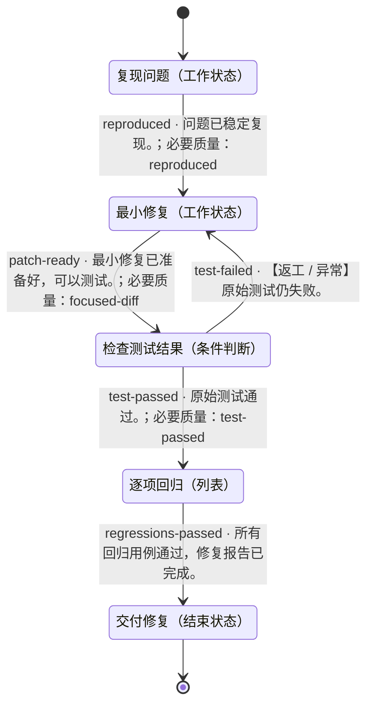

# 修复 Bug 并验证

- 状态机：`demo-bugfix`
- 定义版本：`1.0.0`
- 入口：复现问题（`reproduce`）

## 用途

> 修复购物车合计忽略数量的问题，交付最小改动和回归报告，并保留修复前后的真实测试结果。

## 状态机总览

以下为完整状态机定义。连线标注迁移 ID、跳转条件及必要质量项；返工、异常和循环均保留。子状态机内部结束后返回父层级。

## 推进方式

使用自己的 Agent 读取本定义、检查实际证据并维护状态。无需调用 DecoupleFlow 或其他决策服务。

## 使用约定

由宿主 Agent 使用本状态机。节点内如何完成工作由 Agent 自主决定；条件满足后，依据已定义的迁移更新当前状态。

业务材料和工具由宿主管理。未知条件不等于满足条件；工具请求受理不等于任务完成。仅对迁移显式引用的质量项进行该次跳转的必要检查，其余质量项用于改进结果。

子状态机有独立入口；进入子状态机后从内部入口开始，内部结束状态表示返回父状态机，再检查该子状态机节点的出边。记录完整状态路径，避免混淆不同层级。

## 状态一览

| ID | 状态 | 类型 | 所属层级 |
|---|---|---|---|
| `done` | 交付修复 | 结束状态 | 顶层 |
| `fix` | 最小修复 | 工作状态 | 顶层 |
| `regression` | 逐项回归 | 列表 | 顶层 |
| `reproduce` | 复现问题 | 工作状态 | 顶层 |
| `verify` | 检查测试结果 | 条件判断 | 顶层 |

## 跳转一览

| 跳转 ID | 从 | 到 | 条件 | 路径类型 | 必要质量项 |
|---|---|---|---|---|---|
| `patch-ready` | 最小修复 | 检查测试结果 | 最小修复已准备好，可以测试。 | 正常 | `focused-diff` |
| `regressions-passed` | 逐项回归 | 交付修复 | 所有回归用例通过，修复报告已完成。 | 正常 | — |
| `reproduced` | 复现问题 | 最小修复 | 问题已稳定复现。 | 正常 | `reproduced` |
| `test-failed` | 检查测试结果 | 最小修复 | 原始测试仍失败。 | 返工 / 异常 | — |
| `test-passed` | 检查测试结果 | 逐项回归 | 原始测试通过。 | 正常 | `test-passed` |

## 交付修复 · done

类型：结束状态

### 状态说明

> 交付修改后的代码及 artifacts/fix-report.md，说明原因、改动与回归结果。

### 进入条件

_未填写_

### 质量条件

未单独定义。

结束结果：success。结束当前任务实例。

### 工具调用说明

_未填写_

### 配置说明

_未填写_

### 当前状态的处理策略

> 使用宿主 Agent 完成工作，在任务目录保存简要证据。

### 失败时的处理

> 记录具体缺口，不将失败标记为通过。

### 无法判断时

> 保留当前状态，补充缺失信息。

### 下个步骤

这是结束状态。

## 最小修复 · fix

类型：工作状态

### 状态说明

> 修复 sample/cart.mjs，保留导出函数、输入格式及测试断言。

### 进入条件

_未填写_

### 质量条件

- `focused-diff` · 迁移检查项：改动针对数量计算，没有无关修改。

### 工具调用说明

_未填写_

### 配置说明

> 只修改计算逻辑，不削弱、跳过或删除测试。

### 当前状态的处理策略

> 使用宿主 Agent 完成工作，在任务目录保存简要证据。

### 失败时的处理

> 记录具体缺口，不将失败标记为通过。

### 无法判断时

> 保留当前状态，补充缺失信息。

### 下个步骤

- **检查测试结果**（`verify`），迁移 `patch-ready`
  - 条件：最小修复已准备好，可以测试。
  - 路径类型：正常
  - 必要质量项：focused-diff
  - 不确定时：证据能够支持这条路径之前，保留当前状态。

## 逐项回归 · regression

类型：列表

### 状态说明

> 按顺序检查三个用例，分别保留测试结果；全部通过后才检查出口。

### 进入条件

_未填写_

### 质量条件

- `case-evidence` · 迁移检查项：输出能对应当前用例，且断言通过。

### 按序事项

1. `empty` · 空购物车返回 0
2. `single` · 单商品按数量计价
3. `multiple` · 多商品正确合计

### 统一通过条件

> 当前指定用例确实执行、通过，并已保存输出。

按列表顺序处理，每项都重新检查统一通过条件和本状态的必要质量项；未通过或不确定时停留在当前项。全部事项通过后才检查出口条件。暂停与恢复保留当前项，重新进入本状态从第一项开始。

### 工具调用说明

_未填写_

### 配置说明

_未填写_

### 当前状态的处理策略

> 使用宿主 Agent 完成工作，在任务目录保存简要证据。

### 失败时的处理

> 记录具体缺口，不将失败标记为通过。

### 无法判断时

> 保留当前状态，补充缺失信息。

### 下个步骤

- **交付修复**（`done`），迁移 `regressions-passed`
  - 条件：所有回归用例通过，修复报告已完成。
  - 路径类型：正常
  - 必要质量项：无额外引用
  - 不确定时：证据能够支持这条路径之前，保留当前状态。

## 复现问题 · reproduce

类型：工作状态

### 状态说明

> 阅读 sample/bug-report.md，使用 node --test 执行 sample/cart.test.mjs，将失败输出保存到 artifacts/before.tap。

### 进入条件

_未填写_

### 质量条件

- `reproduced` · 迁移检查项：数量示例确实失败，已记录实际合计与预期合计。

### 工具调用说明

> 在任务目录执行测试，保留失败断言及输入。

### 配置说明

_未填写_

### 当前状态的处理策略

> 使用宿主 Agent 完成工作，在任务目录保存简要证据。

### 失败时的处理

> 记录具体缺口，不将失败标记为通过。

### 无法判断时

> 保留当前状态，补充缺失信息。

### 下个步骤

- **最小修复**（`fix`），迁移 `reproduced`
  - 条件：问题已稳定复现。
  - 路径类型：正常
  - 必要质量项：reproduced
  - 不确定时：证据能够支持这条路径之前，保留当前状态。

## 检查测试结果 · verify

类型：条件判断

### 状态说明

> 再次执行原始复现测试，依据实际退出码和输出选择路径。

### 进入条件

_未填写_

### 质量条件

- `test-passed` · 迁移检查项：原始失败用例已通过，且断言未被修改。

### 进入路径

任一入路满足条件后可以到达此节点；每次到达后重新判断出路。

- 来自 **最小修复**，迁移 `patch-ready`：最小修复已准备好，可以测试。

### 分支选择策略

> 每次从任一入路到达后，结合当前上下文检查各出路的条件、必要质量项与目标进入条件，沿明确满足条件的路径迁移。没有匹配、证据不足或多个条件冲突时保留当前状态，核实后再选择。

### 工具调用说明

_未填写_

### 配置说明

_未填写_

### 当前状态的处理策略

> 使用宿主 Agent 完成工作，在任务目录保存简要证据。

### 失败时的处理

> 记录具体缺口，不将失败标记为通过。

### 无法判断时

> 保留当前状态，补充缺失信息。

### 下个步骤

- **最小修复**（`fix`），迁移 `test-failed`
  - 条件：原始测试仍失败。
  - 路径类型：返工 / 异常
  - 必要质量项：无额外引用
  - 不确定时：证据能够支持这条路径之前，保留当前状态。

- **逐项回归**（`regression`），迁移 `test-passed`
  - 条件：原始测试通过。
  - 路径类型：正常
  - 必要质量项：test-passed
  - 不确定时：证据能够支持这条路径之前，保留当前状态。
