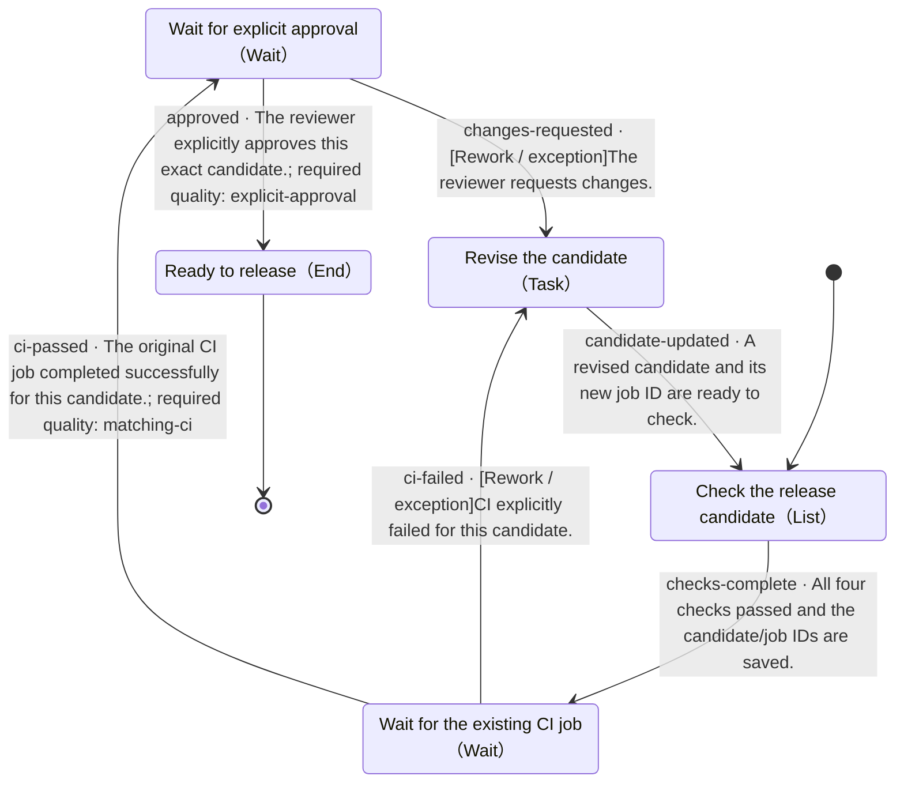

# Release readiness

- State machine: `demo-release`
- Definition version: `1.0.0`
- Entry: Check the release candidate (`checklist`)

## Purpose

> Check a release candidate, wait for its existing CI job, and request approval for that exact candidate. Finish with a release-ready record; publishing remains a separate user action.

## State machine overview

This diagram shows the complete state machine definition. Edges include transition IDs, conditions, and required quality items. Rework, exceptions, and loops are preserved. Internal subflow end states return to their parent level.

## Process driver

Your own agent reads this definition, checks actual evidence, and maintains the state. No DecoupleFlow or decision service is required.

## Usage conventions

The host agent uses this state machine and decides how to perform work within each node. Update the current state along a defined transition only when its conditions are met.

The host manages business materials and tools. An unknown condition is not a satisfied condition; an accepted tool request is not a completed task. Check the quality items explicitly referenced by the chosen transition. Other quality items guide improvements.

Each subflow has its own entry. Start there when entering a subflow. An internal end state returns to its parent, after which the parent node checks its outgoing paths. Record the full state path to distinguish levels.

## States

| ID | State | Type | Parent |
|---|---|---|---|
| `approval` | Wait for explicit approval | Wait | Top level |
| `checklist` | Check the release candidate | List | Top level |
| `ci` | Wait for the existing CI job | Wait | Top level |
| `ready` | Ready to release | End | Top level |
| `revise` | Revise the candidate | Task | Top level |

## Transitions

| Transition ID | From | To | Condition | Path type | Required quality |
|---|---|---|---|---|---|
| `approved` | Wait for explicit approval | Ready to release | The reviewer explicitly approves this exact candidate. | Normal | `explicit-approval` |
| `candidate-updated` | Revise the candidate | Check the release candidate | A revised candidate and its new job ID are ready to check. | Normal | — |
| `changes-requested` | Wait for explicit approval | Revise the candidate | The reviewer requests changes. | Rework / exception | — |
| `checks-complete` | Check the release candidate | Wait for the existing CI job | All four checks passed and the candidate/job IDs are saved. | Normal | — |
| `ci-failed` | Wait for the existing CI job | Revise the candidate | CI explicitly failed for this candidate. | Rework / exception | — |
| `ci-passed` | Wait for the existing CI job | Wait for explicit approval | The original CI job completed successfully for this candidate. | Normal | `matching-ci` |

## Wait for explicit approval · approval

Type: Wait

### State description

> Ask the reviewer to approve the exact candidate. Silence, old approvals, and the agent's own opinion are not approval.

### Entry conditions

_Not specified_

### Quality conditions

- `explicit-approval` · Transition check：A reviewer explicitly approved this candidate after CI succeeded.

### Tool guidance

> Use a human reply or approved host event. The offline demo reads the clearly labeled fixture sample/approval.json.

### Configuration

_Not specified_

### Strategy during this state

> Use the host agent and record concise evidence in the task workspace.

### On failure

> Record the concrete gap; do not mark it as passed.

### When uncertain

> Keep this state and ask for the missing information.

### Next steps

- **Ready to release** (`ready`), transition `approved`
  - Condition: The reviewer explicitly approves this exact candidate.
  - Path type: Normal
  - Required quality: explicit-approval
  - When uncertain: Hold this state until the evidence supports this path.

- **Revise the candidate** (`revise`), transition `changes-requested`
  - Condition: The reviewer requests changes.
  - Path type: Rework / exception
  - Required quality: No additional references
  - When uncertain: Hold this state until the evidence supports this path.

## Check the release candidate · checklist

Type: List

### State description

> Read sample/release.json. Check the four items in order and write artifacts/checklist.md for this candidate.

### Entry conditions

_Not specified_

### Quality conditions

- `candidate-evidence` · Transition check：The evidence identifies the candidate and the checked item.

### Ordered items

1. `version` · Version and release notes agree
2. `license` · License file is present
3. `tests` · Test result belongs to this candidate
4. `docs` · Install instructions are complete

### Shared pass condition

> This item has an explicit passing result and evidence for the current candidate.

Process the list in order. Recheck the shared pass condition and this state’s required quality checks for each item; stay on the current item if it fails or is uncertain. Check exit conditions only after all items pass. Pause and resume preserve the current item; reentering this state starts from the first item.

### Tool guidance

_Not specified_

### Configuration

_Not specified_

### Strategy during this state

> Use the host agent and record concise evidence in the task workspace.

### On failure

> Record the concrete gap; do not mark it as passed.

### When uncertain

> Keep this state and ask for the missing information.

### Next steps

- **Wait for the existing CI job** (`ci`), transition `checks-complete`
  - Condition: All four checks passed and the candidate/job IDs are saved.
  - Path type: Normal
  - Required quality: No additional references
  - When uncertain: Hold this state until the evidence supports this path.

## Wait for the existing CI job · ci

Type: Wait

### State description

> Use jobId and candidateId from sample/release.json. Wait for an actual completion event for that same job and candidate.

### Entry conditions

_Not specified_

### Quality conditions

- `matching-ci` · Transition check：CI succeeded for the saved jobId and candidateId.

### Tool guidance

> Query the original job or receive its callback. The demo uses sample/ci-result.json; a real project must use its actual CI result.

### Configuration

> Do not submit another build on resume. Pending or timeout without a result means hold.

### Strategy during this state

> Use the host agent and record concise evidence in the task workspace.

### On failure

> Record the concrete gap; do not mark it as passed.

### When uncertain

> Keep this state and ask for the missing information.

### Next steps

- **Revise the candidate** (`revise`), transition `ci-failed`
  - Condition: CI explicitly failed for this candidate.
  - Path type: Rework / exception
  - Required quality: No additional references
  - When uncertain: Hold this state until the evidence supports this path.

- **Wait for explicit approval** (`approval`), transition `ci-passed`
  - Condition: The original CI job completed successfully for this candidate.
  - Path type: Normal
  - Required quality: matching-ci
  - When uncertain: Hold this state until the evidence supports this path.

## Ready to release · ready

Type: End

### State description

> Write artifacts/release-ready.md with checklist evidence, CI job, candidate, and reviewer approval. Do not publish, push tags, or deploy.

### Entry conditions

_Not specified_

### Quality conditions

None defined.

Outcome: success. End the current task instance.

### Tool guidance

_Not specified_

### Configuration

_Not specified_

### Strategy during this state

> Use the host agent and record concise evidence in the task workspace.

### On failure

> Record the concrete gap; do not mark it as passed.

### When uncertain

> Keep this state and ask for the missing information.

### Next steps

This is an end state.

## Revise the candidate · revise

Type: Task

### State description

> Address the failed checks or review comments. A changed candidate needs a new ID, new CI evidence, and fresh approval; repeat the checklist.

### Entry conditions

_Not specified_

### Quality conditions

None defined.

### Tool guidance

_Not specified_

### Configuration

_Not specified_

### Strategy during this state

> Use the host agent and record concise evidence in the task workspace.

### On failure

> Record the concrete gap; do not mark it as passed.

### When uncertain

> Keep this state and ask for the missing information.

### Next steps

- **Check the release candidate** (`checklist`), transition `candidate-updated`
  - Condition: A revised candidate and its new job ID are ready to check.
  - Path type: Normal
  - Required quality: No additional references
  - When uncertain: Hold this state until the evidence supports this path.
