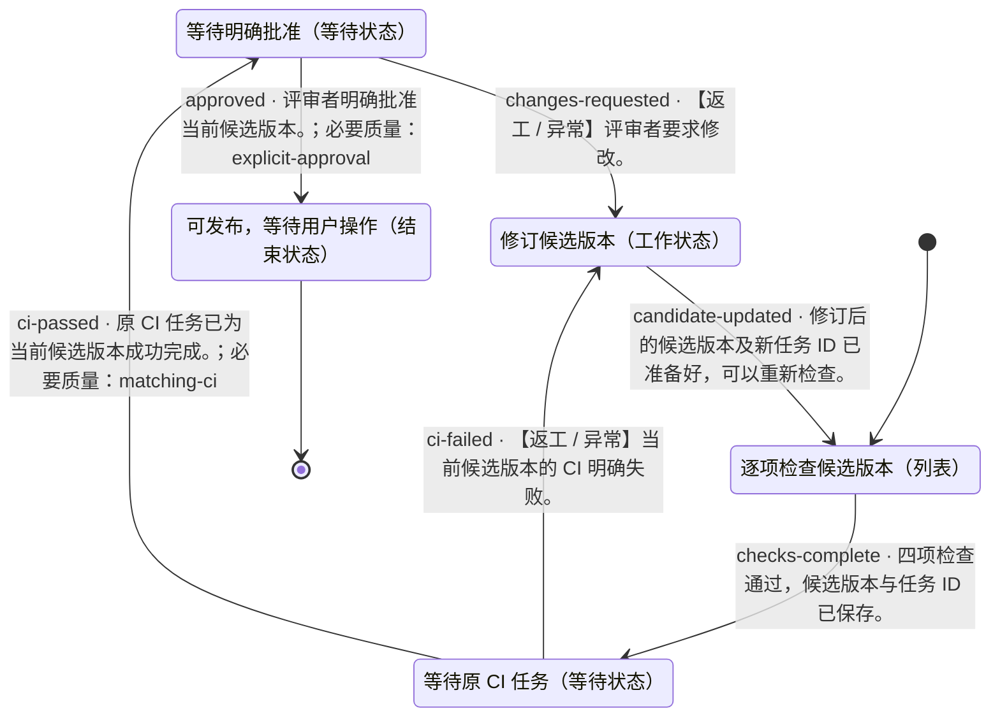

# 发布前逐项验收

- 状态机：`demo-release`
- 定义版本：`1.0.0`
- 入口：逐项检查候选版本（`checklist`）

## 用途

> 检查候选版本，等待原 CI 任务，并请求对该版本的明确批准。最终交付可发布记录，实际发布由用户另行操作。

## 状态机总览

以下为完整状态机定义。连线标注迁移 ID、跳转条件及必要质量项；返工、异常和循环均保留。子状态机内部结束后返回父层级。

## 推进方式

使用自己的 Agent 读取本定义、检查实际证据并维护状态。无需调用 DecoupleFlow 或其他决策服务。

## 使用约定

由宿主 Agent 使用本状态机。节点内如何完成工作由 Agent 自主决定；条件满足后，依据已定义的迁移更新当前状态。

业务材料和工具由宿主管理。未知条件不等于满足条件；工具请求受理不等于任务完成。仅对迁移显式引用的质量项进行该次跳转的必要检查，其余质量项用于改进结果。

子状态机有独立入口；进入子状态机后从内部入口开始，内部结束状态表示返回父状态机，再检查该子状态机节点的出边。记录完整状态路径，避免混淆不同层级。

## 状态一览

| ID | 状态 | 类型 | 所属层级 |
|---|---|---|---|
| `approval` | 等待明确批准 | 等待状态 | 顶层 |
| `checklist` | 逐项检查候选版本 | 列表 | 顶层 |
| `ci` | 等待原 CI 任务 | 等待状态 | 顶层 |
| `ready` | 可发布，等待用户操作 | 结束状态 | 顶层 |
| `revise` | 修订候选版本 | 工作状态 | 顶层 |

## 跳转一览

| 跳转 ID | 从 | 到 | 条件 | 路径类型 | 必要质量项 |
|---|---|---|---|---|---|
| `approved` | 等待明确批准 | 可发布，等待用户操作 | 评审者明确批准当前候选版本。 | 正常 | `explicit-approval` |
| `candidate-updated` | 修订候选版本 | 逐项检查候选版本 | 修订后的候选版本及新任务 ID 已准备好，可以重新检查。 | 正常 | — |
| `changes-requested` | 等待明确批准 | 修订候选版本 | 评审者要求修改。 | 返工 / 异常 | — |
| `checks-complete` | 逐项检查候选版本 | 等待原 CI 任务 | 四项检查通过，候选版本与任务 ID 已保存。 | 正常 | — |
| `ci-failed` | 等待原 CI 任务 | 修订候选版本 | 当前候选版本的 CI 明确失败。 | 返工 / 异常 | — |
| `ci-passed` | 等待原 CI 任务 | 等待明确批准 | 原 CI 任务已为当前候选版本成功完成。 | 正常 | `matching-ci` |

## 等待明确批准 · approval

类型：等待状态

### 状态说明

> 请评审者明确批准当前候选版本。沉默、旧版本的批准、Agent 自己的判断都不算批准。

### 进入条件

_未填写_

### 质量条件

- `explicit-approval` · 迁移检查项：CI 成功后，评审者明确批准了当前候选版本。

### 工具调用说明

> 使用人工回复或获批的宿主事件；离线演练读取已明确标记为示例的 sample/approval.json。

### 配置说明

_未填写_

### 当前状态的处理策略

> 使用宿主 Agent 完成工作，在任务目录保存简要证据。

### 失败时的处理

> 记录具体缺口，不将失败标记为通过。

### 无法判断时

> 保留当前状态，补充缺失信息。

### 下个步骤

- **可发布，等待用户操作**（`ready`），迁移 `approved`
  - 条件：评审者明确批准当前候选版本。
  - 路径类型：正常
  - 必要质量项：explicit-approval
  - 不确定时：证据能够支持这条路径之前，保留当前状态。

- **修订候选版本**（`revise`），迁移 `changes-requested`
  - 条件：评审者要求修改。
  - 路径类型：返工 / 异常
  - 必要质量项：无额外引用
  - 不确定时：证据能够支持这条路径之前，保留当前状态。

## 逐项检查候选版本 · checklist

类型：列表

### 状态说明

> 阅读 sample/release.json，按顺序完成四项检查，将该候选版本的结果写入 artifacts/checklist.md。

### 进入条件

_未填写_

### 质量条件

- `candidate-evidence` · 迁移检查项：证据能对应候选版本与当前检查项。

### 按序事项

1. `version` · 版本与更新说明一致
2. `license` · 许可证文件存在
3. `tests` · 测试结果属于当前候选版本
4. `docs` · 安装说明完整

### 统一通过条件

> 当前事项有明确通过结果，并附当前候选版本的证据。

按列表顺序处理，每项都重新检查统一通过条件和本状态的必要质量项；未通过或不确定时停留在当前项。全部事项通过后才检查出口条件。暂停与恢复保留当前项，重新进入本状态从第一项开始。

### 工具调用说明

_未填写_

### 配置说明

_未填写_

### 当前状态的处理策略

> 使用宿主 Agent 完成工作，在任务目录保存简要证据。

### 失败时的处理

> 记录具体缺口，不将失败标记为通过。

### 无法判断时

> 保留当前状态，补充缺失信息。

### 下个步骤

- **等待原 CI 任务**（`ci`），迁移 `checks-complete`
  - 条件：四项检查通过，候选版本与任务 ID 已保存。
  - 路径类型：正常
  - 必要质量项：无额外引用
  - 不确定时：证据能够支持这条路径之前，保留当前状态。

## 等待原 CI 任务 · ci

类型：等待状态

### 状态说明

> 沿用 sample/release.json 中的 jobId、candidateId；等待同一任务、同一候选版本的实际完成事件。

### 进入条件

_未填写_

### 质量条件

- `matching-ci` · 迁移检查项：保存的 jobId、candidateId 对应的 CI 明确成功。

### 工具调用说明

> 查询原任务或接收回调；示例使用 sample/ci-result.json，实际项目须使用真实 CI 结果。

### 配置说明

> 恢复时不再次提交构建；pending 或没有结果的超时都保持等待。

### 当前状态的处理策略

> 使用宿主 Agent 完成工作，在任务目录保存简要证据。

### 失败时的处理

> 记录具体缺口，不将失败标记为通过。

### 无法判断时

> 保留当前状态，补充缺失信息。

### 下个步骤

- **修订候选版本**（`revise`），迁移 `ci-failed`
  - 条件：当前候选版本的 CI 明确失败。
  - 路径类型：返工 / 异常
  - 必要质量项：无额外引用
  - 不确定时：证据能够支持这条路径之前，保留当前状态。

- **等待明确批准**（`approval`），迁移 `ci-passed`
  - 条件：原 CI 任务已为当前候选版本成功完成。
  - 路径类型：正常
  - 必要质量项：matching-ci
  - 不确定时：证据能够支持这条路径之前，保留当前状态。

## 可发布，等待用户操作 · ready

类型：结束状态

### 状态说明

> 编写 artifacts/release-ready.md，列出清单证据、CI 任务、候选版本与批准记录；不自动发布、推送标签或部署。

### 进入条件

_未填写_

### 质量条件

未单独定义。

结束结果：success。结束当前任务实例。

### 工具调用说明

_未填写_

### 配置说明

_未填写_

### 当前状态的处理策略

> 使用宿主 Agent 完成工作，在任务目录保存简要证据。

### 失败时的处理

> 记录具体缺口，不将失败标记为通过。

### 无法判断时

> 保留当前状态，补充缺失信息。

### 下个步骤

这是结束状态。

## 修订候选版本 · revise

类型：工作状态

### 状态说明

> 根据失败检查或评审意见修订。修改后的版本须有新的候选 ID、CI 证据和批准，并重新完成清单。

### 进入条件

_未填写_

### 质量条件

未单独定义。

### 工具调用说明

_未填写_

### 配置说明

_未填写_

### 当前状态的处理策略

> 使用宿主 Agent 完成工作，在任务目录保存简要证据。

### 失败时的处理

> 记录具体缺口，不将失败标记为通过。

### 无法判断时

> 保留当前状态，补充缺失信息。

### 下个步骤

- **逐项检查候选版本**（`checklist`），迁移 `candidate-updated`
  - 条件：修订后的候选版本及新任务 ID 已准备好，可以重新检查。
  - 路径类型：正常
  - 必要质量项：无额外引用
  - 不确定时：证据能够支持这条路径之前，保留当前状态。
