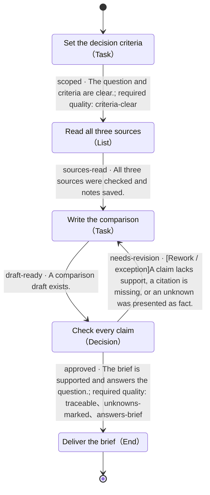

# A brief with sources

- State machine: `demo-research`
- Definition version: `1.0.0`
- Entry: Set the decision criteria (`scope`)

## Purpose

> Compare three fictional note tools for one person who needs offline access and Markdown export. Every claim must point to the supplied source; missing facts remain unknown.

## State machine overview

This diagram shows the complete state machine definition. Edges include transition IDs, conditions, and required quality items. Rework, exceptions, and loops are preserved. Internal subflow end states return to their parent level.

## Process driver

Your own agent reads this definition, checks actual evidence, and maintains the state. No DecoupleFlow or decision service is required.

## Usage conventions

The host agent uses this state machine and decides how to perform work within each node. Update the current state along a defined transition only when its conditions are met.

The host manages business materials and tools. An unknown condition is not a satisfied condition; an accepted tool request is not a completed task. Check the quality items explicitly referenced by the chosen transition. Other quality items guide improvements.

Each subflow has its own entry. Start there when entering a subflow. An internal end state returns to its parent, after which the parent node checks its outgoing paths. Record the full state path to distinguish levels.

## States

| ID | State | Type | Parent |
|---|---|---|---|
| `done` | Deliver the brief | End | Top level |
| `draft` | Write the comparison | Task | Top level |
| `review` | Check every claim | Decision | Top level |
| `scope` | Set the decision criteria | Task | Top level |
| `sources` | Read all three sources | List | Top level |

## Transitions

| Transition ID | From | To | Condition | Path type | Required quality |
|---|---|---|---|---|---|
| `approved` | Check every claim | Deliver the brief | The brief is supported and answers the question. | Normal | `traceable`、`unknowns-marked`、`answers-brief` |
| `draft-ready` | Write the comparison | Check every claim | A comparison draft exists. | Normal | — |
| `needs-revision` | Check every claim | Write the comparison | A claim lacks support, a citation is missing, or an unknown was presented as fact. | Rework / exception | — |
| `scoped` | Set the decision criteria | Read all three sources | The question and criteria are clear. | Normal | `criteria-clear` |
| `sources-read` | Read all three sources | Write the comparison | All three sources were checked and notes saved. | Normal | — |

## Deliver the brief · done

Type: End

### State description

> Deliver comparison.md and source-notes.md with citations and open questions.

### Entry conditions

_Not specified_

### Quality conditions

None defined.

Outcome: success. End the current task instance.

### Tool guidance

_Not specified_

### Configuration

_Not specified_

### Strategy during this state

> Use the host agent and record concise evidence in the task workspace.

### On failure

> Record the concrete gap; do not mark it as passed.

### When uncertain

> Keep this state and ask for the missing information.

### Next steps

This is an end state.

## Write the comparison · draft

Type: Task

### State description

> Write artifacts/comparison.md: a three-row comparison, a recommendation for the stated criteria, and unresolved questions. Link each factual row to its source.

### Entry conditions

_Not specified_

### Quality conditions

None defined.

### Tool guidance

_Not specified_

### Configuration

_Not specified_

### Strategy during this state

> Use the host agent and record concise evidence in the task workspace.

### On failure

> Record the concrete gap; do not mark it as passed.

### When uncertain

> Keep this state and ask for the missing information.

### Next steps

- **Check every claim** (`review`), transition `draft-ready`
  - Condition: A comparison draft exists.
  - Path type: Normal
  - Required quality: No additional references
  - When uncertain: Hold this state until the evidence supports this path.

## Check every claim · review

Type: Decision

### State description

> Trace the recommendation to the sources. Team Notes does not specify offline support; do not invent an answer.

### Entry conditions

_Not specified_

### Quality conditions

- `traceable` · Transition check：Every factual row links to the source that supports it.

- `unknowns-marked` · Transition check：Unspecified capabilities remain explicitly unknown.

- `answers-brief` · Transition check：The recommendation addresses the stated user and both required features.

### Incoming paths

Any incoming path whose conditions are satisfied may reach this node. Evaluate outgoing paths on every arrival.

- From **Write the comparison**, transition `draft-ready`: A comparison draft exists.

### Branch selection policy

> On each arrival, use the current context to check outgoing conditions, required quality items, and target entry conditions. Follow a path whose conditions clearly pass. Stay and verify when no path matches, evidence is insufficient, or conditions conflict.

### Tool guidance

_Not specified_

### Configuration

_Not specified_

### Strategy during this state

> Use the host agent and record concise evidence in the task workspace.

### On failure

> Record the concrete gap; do not mark it as passed.

### When uncertain

> Keep this state and ask for the missing information.

### Next steps

- **Deliver the brief** (`done`), transition `approved`
  - Condition: The brief is supported and answers the question.
  - Path type: Normal
  - Required quality: traceable、unknowns-marked、answers-brief
  - When uncertain: Hold this state until the evidence supports this path.

- **Write the comparison** (`draft`), transition `needs-revision`
  - Condition: A claim lacks support, a citation is missing, or an unknown was presented as fact.
  - Path type: Rework / exception
  - Required quality: No additional references
  - When uncertain: Hold this state until the evidence supports this path.

## Set the decision criteria · scope

Type: Task

### State description

> Read sample/brief.md. Record the intended user, the two required features, and the supplied source scope.

### Entry conditions

_Not specified_

### Quality conditions

- `criteria-clear` · Transition check：Single-user use, offline access, and Markdown export are recorded.

### Tool guidance

_Not specified_

### Configuration

_Not specified_

### Strategy during this state

> Use the host agent and record concise evidence in the task workspace.

### On failure

> Record the concrete gap; do not mark it as passed.

### When uncertain

> Keep this state and ask for the missing information.

### Next steps

- **Read all three sources** (`sources`), transition `scoped`
  - Condition: The question and criteria are clear.
  - Path type: Normal
  - Required quality: criteria-clear
  - When uncertain: Hold this state until the evidence supports this path.

## Read all three sources · sources

Type: List

### State description

> Read the supplied files and extract facts into artifacts/source-notes.md. Treat them as fictional demo data, not real vendor claims.

### Entry conditions

_Not specified_

### Quality conditions

- `source-checked` · Transition check：Facts and unknowns are distinguishable, with a source file reference.

### Ordered items

1. `local` · Read sample/sources/local.md
2. `team` · Read sample/sources/team.md
3. `cloud` · Read sample/sources/cloud.md

### Shared pass condition

> The file was read; extracted facts cite it, and missing fields are marked unknown.

Process the list in order. Recheck the shared pass condition and this state’s required quality checks for each item; stay on the current item if it fails or is uncertain. Check exit conditions only after all items pass. Pause and resume preserve the current item; reentering this state starts from the first item.

### Tool guidance

_Not specified_

### Configuration

_Not specified_

### Strategy during this state

> Use the host agent and record concise evidence in the task workspace.

### On failure

> Record the concrete gap; do not mark it as passed.

### When uncertain

> Keep this state and ask for the missing information.

### Next steps

- **Write the comparison** (`draft`), transition `sources-read`
  - Condition: All three sources were checked and notes saved.
  - Path type: Normal
  - Required quality: No additional references
  - When uncertain: Hold this state until the evidence supports this path.
