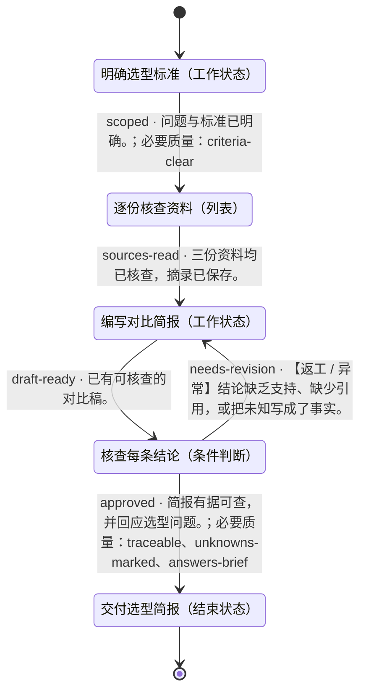

# 带来源的选型简报

- 状态机：`demo-research`
- 定义版本：`1.0.0`
- 入口：明确选型标准（`scope`）

## 用途

> 为需要离线使用、Markdown 导出的个人用户，对比三个虚构笔记工具。每条结论指向给定来源，未提供的信息保留为未知。

## 状态机总览

以下为完整状态机定义。连线标注迁移 ID、跳转条件及必要质量项；返工、异常和循环均保留。子状态机内部结束后返回父层级。

## 推进方式

使用自己的 Agent 读取本定义、检查实际证据并维护状态。无需调用 DecoupleFlow 或其他决策服务。

## 使用约定

由宿主 Agent 使用本状态机。节点内如何完成工作由 Agent 自主决定；条件满足后，依据已定义的迁移更新当前状态。

业务材料和工具由宿主管理。未知条件不等于满足条件；工具请求受理不等于任务完成。仅对迁移显式引用的质量项进行该次跳转的必要检查，其余质量项用于改进结果。

子状态机有独立入口；进入子状态机后从内部入口开始，内部结束状态表示返回父状态机，再检查该子状态机节点的出边。记录完整状态路径，避免混淆不同层级。

## 状态一览

| ID | 状态 | 类型 | 所属层级 |
|---|---|---|---|
| `done` | 交付选型简报 | 结束状态 | 顶层 |
| `draft` | 编写对比简报 | 工作状态 | 顶层 |
| `review` | 核查每条结论 | 条件判断 | 顶层 |
| `scope` | 明确选型标准 | 工作状态 | 顶层 |
| `sources` | 逐份核查资料 | 列表 | 顶层 |

## 跳转一览

| 跳转 ID | 从 | 到 | 条件 | 路径类型 | 必要质量项 |
|---|---|---|---|---|---|
| `approved` | 核查每条结论 | 交付选型简报 | 简报有据可查，并回应选型问题。 | 正常 | `traceable`、`unknowns-marked`、`answers-brief` |
| `draft-ready` | 编写对比简报 | 核查每条结论 | 已有可核查的对比稿。 | 正常 | — |
| `needs-revision` | 核查每条结论 | 编写对比简报 | 结论缺乏支持、缺少引用，或把未知写成了事实。 | 返工 / 异常 | — |
| `scoped` | 明确选型标准 | 逐份核查资料 | 问题与标准已明确。 | 正常 | `criteria-clear` |
| `sources-read` | 逐份核查资料 | 编写对比简报 | 三份资料均已核查，摘录已保存。 | 正常 | — |

## 交付选型简报 · done

类型：结束状态

### 状态说明

> 交付 comparison.md 与 source-notes.md，保留引用和待确认问题。

### 进入条件

_未填写_

### 质量条件

未单独定义。

结束结果：success。结束当前任务实例。

### 工具调用说明

_未填写_

### 配置说明

_未填写_

### 当前状态的处理策略

> 使用宿主 Agent 完成工作，在任务目录保存简要证据。

### 失败时的处理

> 记录具体缺口，不将失败标记为通过。

### 无法判断时

> 保留当前状态，补充缺失信息。

### 下个步骤

这是结束状态。

## 编写对比简报 · draft

类型：工作状态

### 状态说明

> 编写 artifacts/comparison.md：三项对比、针对既定标准的建议、待确认问题；每行事实链接到对应来源。

### 进入条件

_未填写_

### 质量条件

未单独定义。

### 工具调用说明

_未填写_

### 配置说明

_未填写_

### 当前状态的处理策略

> 使用宿主 Agent 完成工作，在任务目录保存简要证据。

### 失败时的处理

> 记录具体缺口，不将失败标记为通过。

### 无法判断时

> 保留当前状态，补充缺失信息。

### 下个步骤

- **核查每条结论**（`review`），迁移 `draft-ready`
  - 条件：已有可核查的对比稿。
  - 路径类型：正常
  - 必要质量项：无额外引用
  - 不确定时：证据能够支持这条路径之前，保留当前状态。

## 核查每条结论 · review

类型：条件判断

### 状态说明

> 将建议逐条对应到资料。Team Notes 未说明离线能力，不能补造答案。

### 进入条件

_未填写_

### 质量条件

- `traceable` · 迁移检查项：每行事实都有支持它的来源链接。

- `unknowns-marked` · 迁移检查项：未说明的能力仍明确标记为未知。

- `answers-brief` · 迁移检查项：建议回应目标用户及两项必要能力。

### 进入路径

任一入路满足条件后可以到达此节点；每次到达后重新判断出路。

- 来自 **编写对比简报**，迁移 `draft-ready`：已有可核查的对比稿。

### 分支选择策略

> 每次从任一入路到达后，结合当前上下文检查各出路的条件、必要质量项与目标进入条件，沿明确满足条件的路径迁移。没有匹配、证据不足或多个条件冲突时保留当前状态，核实后再选择。

### 工具调用说明

_未填写_

### 配置说明

_未填写_

### 当前状态的处理策略

> 使用宿主 Agent 完成工作，在任务目录保存简要证据。

### 失败时的处理

> 记录具体缺口，不将失败标记为通过。

### 无法判断时

> 保留当前状态，补充缺失信息。

### 下个步骤

- **交付选型简报**（`done`），迁移 `approved`
  - 条件：简报有据可查，并回应选型问题。
  - 路径类型：正常
  - 必要质量项：traceable、unknowns-marked、answers-brief
  - 不确定时：证据能够支持这条路径之前，保留当前状态。

- **编写对比简报**（`draft`），迁移 `needs-revision`
  - 条件：结论缺乏支持、缺少引用，或把未知写成了事实。
  - 路径类型：返工 / 异常
  - 必要质量项：无额外引用
  - 不确定时：证据能够支持这条路径之前，保留当前状态。

## 明确选型标准 · scope

类型：工作状态

### 状态说明

> 阅读 sample/brief.md，记录目标用户、两项必要能力，以及本次资料范围。

### 进入条件

_未填写_

### 质量条件

- `criteria-clear` · 迁移检查项：已记录个人使用、离线能力、Markdown 导出要求。

### 工具调用说明

_未填写_

### 配置说明

_未填写_

### 当前状态的处理策略

> 使用宿主 Agent 完成工作，在任务目录保存简要证据。

### 失败时的处理

> 记录具体缺口，不将失败标记为通过。

### 无法判断时

> 保留当前状态，补充缺失信息。

### 下个步骤

- **逐份核查资料**（`sources`），迁移 `scoped`
  - 条件：问题与标准已明确。
  - 路径类型：正常
  - 必要质量项：criteria-clear
  - 不确定时：证据能够支持这条路径之前，保留当前状态。

## 逐份核查资料 · sources

类型：列表

### 状态说明

> 阅读给定文件，将事实摘录至 artifacts/source-notes.md；这些是虚构示例资料，不是真实厂商承诺。

### 进入条件

_未填写_

### 质量条件

- `source-checked` · 迁移检查项：事实与未知项可区分，并附来源文件引用。

### 按序事项

1. `local` · 阅读 sample/sources/local.md
2. `team` · 阅读 sample/sources/team.md
3. `cloud` · 阅读 sample/sources/cloud.md

### 统一通过条件

> 文件已实际阅读；摘录事实附来源，缺失字段明确记为未知。

按列表顺序处理，每项都重新检查统一通过条件和本状态的必要质量项；未通过或不确定时停留在当前项。全部事项通过后才检查出口条件。暂停与恢复保留当前项，重新进入本状态从第一项开始。

### 工具调用说明

_未填写_

### 配置说明

_未填写_

### 当前状态的处理策略

> 使用宿主 Agent 完成工作，在任务目录保存简要证据。

### 失败时的处理

> 记录具体缺口，不将失败标记为通过。

### 无法判断时

> 保留当前状态，补充缺失信息。

### 下个步骤

- **编写对比简报**（`draft`），迁移 `sources-read`
  - 条件：三份资料均已核查，摘录已保存。
  - 路径类型：正常
  - 必要质量项：无额外引用
  - 不确定时：证据能够支持这条路径之前，保留当前状态。
