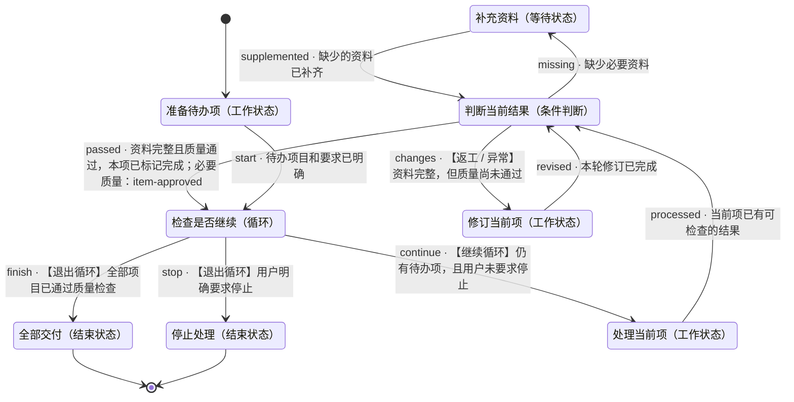

# 循环与条件分支

- 状态机：`loop-and-routing`
- 定义版本：`1.0.0`
- 入口：准备待办项（`prepare`）

## 用途

> 逐项处理任务，每轮按质量与资料条件选择路径，直到全部完成或用户停止。

## 状态机总览

以下为完整状态机定义。连线标注迁移 ID、跳转条件及必要质量项；返工、异常和循环均保留。子状态机内部结束后返回父层级。

## 推进方式

使用自己的 Agent 读取本定义、检查实际证据并维护状态。无需调用 DecoupleFlow 或其他决策服务。

## 使用约定

由宿主 Agent 使用本状态机。节点内如何完成工作由 Agent 自主决定；条件满足后，依据已定义的迁移更新当前状态。

业务材料和工具由宿主管理。未知条件不等于满足条件；工具请求受理不等于任务完成。仅对迁移显式引用的质量项进行该次跳转的必要检查，其余质量项用于改进结果。

子状态机有独立入口；进入子状态机后从内部入口开始，内部结束状态表示返回父状态机，再检查该子状态机节点的出边。记录完整状态路径，避免混淆不同层级。

## 状态一览

| ID | 状态 | 类型 | 所属层级 |
|---|---|---|---|
| `clarify` | 补充资料 | 等待状态 | 顶层 |
| `done` | 全部交付 | 结束状态 | 顶层 |
| `prepare` | 准备待办项 | 工作状态 | 顶层 |
| `repeat` | 检查是否继续 | 循环 | 顶层 |
| `review` | 判断当前结果 | 条件判断 | 顶层 |
| `revise` | 修订当前项 | 工作状态 | 顶层 |
| `stopped` | 停止处理 | 结束状态 | 顶层 |
| `work` | 处理当前项 | 工作状态 | 顶层 |

## 跳转一览

| 跳转 ID | 从 | 到 | 条件 | 路径类型 | 必要质量项 |
|---|---|---|---|---|---|
| `changes` | 判断当前结果 | 修订当前项 | 资料完整，但质量尚未通过 | 返工 / 异常 | — |
| `continue` | 检查是否继续 | 处理当前项 | 仍有待办项，且用户未要求停止 | 正常 · 继续循环 | — |
| `finish` | 检查是否继续 | 全部交付 | 全部项目已通过质量检查 | 正常 · 退出循环 | — |
| `missing` | 判断当前结果 | 补充资料 | 缺少必要资料 | 正常 | — |
| `passed` | 判断当前结果 | 检查是否继续 | 资料完整且质量通过，本项已标记完成 | 正常 | `item-approved` |
| `processed` | 处理当前项 | 判断当前结果 | 当前项已有可检查的结果 | 正常 | — |
| `revised` | 修订当前项 | 判断当前结果 | 本轮修订已完成 | 正常 | — |
| `start` | 准备待办项 | 检查是否继续 | 待办项目和要求已明确 | 正常 | — |
| `stop` | 检查是否继续 | 停止处理 | 用户明确要求停止 | 正常 · 退出循环 | — |
| `supplemented` | 补充资料 | 判断当前结果 | 缺少的资料已补齐 | 正常 | — |

## 补充资料 · clarify

类型：等待状态

### 状态说明

> 等待或取得缺少的资料，然后重新判断。

### 进入条件

_未填写_

### 质量条件

未单独定义。

### 工具调用说明

_未填写_

### 配置说明

_未填写_

### 当前状态的处理策略

> 说明缺少的资料，使用宿主能力等待补充。

### 失败时的处理

> 保留缺口并说明原因。

### 无法判断时

> 继续核实，保留当前状态。

### 下个步骤

- **判断当前结果**（`review`），迁移 `supplemented`
  - 条件：缺少的资料已补齐
  - 路径类型：正常
  - 必要质量项：无额外引用
  - 不确定时：保留当前状态，核实条件后再决定。

## 全部交付 · done

类型：结束状态

### 状态说明

> 交付全部已完成的项目与结果。

### 进入条件

_未填写_

### 质量条件

未单独定义。

结束结果：success。结束当前任务实例。

### 工具调用说明

_未填写_

### 配置说明

_未填写_

### 当前状态的处理策略

_未填写_

### 失败时的处理

_未填写_

### 无法判断时

> 无法判断时保留当前状态，补充信息后再次检查。

### 下个步骤

这是结束状态。

## 准备待办项 · prepare

类型：工作状态

### 状态说明

> 明确待处理项目及每项的完成要求。

### 进入条件

_未填写_

### 质量条件

未单独定义。

### 工具调用说明

_未填写_

### 配置说明

_未填写_

### 当前状态的处理策略

_未填写_

### 失败时的处理

_未填写_

### 无法判断时

> 无法判断时保留当前状态，补充信息后再次检查。

### 下个步骤

- **检查是否继续**（`repeat`），迁移 `start`
  - 条件：待办项目和要求已明确
  - 路径类型：正常
  - 必要质量项：无额外引用
  - 不确定时：保留当前状态，核实条件后再决定。

## 检查是否继续 · repeat

类型：循环

### 状态说明

> 每轮检查剩余事项与停止要求，决定继续处理或退出。

### 进入条件

_未填写_

### 质量条件

未单独定义。

### 进入路径

任一入路满足条件后可以到达此节点；每次到达后重新判断出路。

- 来自 **判断当前结果**，迁移 `passed`：资料完整且质量通过，本项已标记完成

- 来自 **准备待办项**，迁移 `start`：待办项目和要求已明确

### 分支选择策略

> 用户明确要求停止时优先进入停止路径；否则，全部完成时交付，仍有待办时继续。证据不足时保留当前状态并核实。

### 循环规则

进入循环节点时检查继续与退出条件。继续条件成立后进入对应目标，完成本轮后沿已定义的返回路径回到此节点；每轮重新检查条件与质量项。退出条件明确满足后，沿对应退出路径进入下一状态。循环次数、实际工作与等待由宿主 Agent 管理。

### 工具调用说明

_未填写_

### 配置说明

_未填写_

### 当前状态的处理策略

_未填写_

### 失败时的处理

_未填写_

### 无法判断时

> 无法判断时保留当前状态，补充信息后再次检查。

### 下个步骤

- **处理当前项**（`work`），迁移 `continue`
  - 条件：仍有待办项，且用户未要求停止
  - 路径类型：正常
  - 循环路径：继续循环
  - 必要质量项：无额外引用
  - 不确定时：保留当前状态，核实条件后再决定。

- **全部交付**（`done`），迁移 `finish`
  - 条件：全部项目已通过质量检查
  - 路径类型：正常
  - 循环路径：退出循环
  - 必要质量项：无额外引用
  - 不确定时：保留当前状态，核实条件后再决定。

- **停止处理**（`stopped`），迁移 `stop`
  - 条件：用户明确要求停止
  - 路径类型：正常
  - 循环路径：退出循环
  - 必要质量项：无额外引用
  - 不确定时：保留当前状态，核实条件后再决定。

## 判断当前结果 · review

类型：条件判断

### 状态说明

> 根据资料完整度和本项质量检查选择对应路径。

### 进入条件

_未填写_

### 质量条件

- `item-approved` · 迁移检查项：资料完整，本项质量达到要求。

### 进入路径

任一入路满足条件后可以到达此节点；每次到达后重新判断出路。

- 来自 **处理当前项**，迁移 `processed`：当前项已有可检查的结果

- 来自 **修订当前项**，迁移 `revised`：本轮修订已完成

- 来自 **补充资料**，迁移 `supplemented`：缺少的资料已补齐

### 分支选择策略

> 每次从任一入路到达后，结合当前上下文检查各出路的条件、必要质量项与目标进入条件，沿明确满足条件的路径迁移。没有匹配、证据不足或多个条件冲突时保留当前状态，核实后再选择。

### 工具调用说明

_未填写_

### 配置说明

_未填写_

### 当前状态的处理策略

_未填写_

### 失败时的处理

_未填写_

### 无法判断时

> 无法判断时保留当前状态，补充信息后再次检查。

### 下个步骤

- **修订当前项**（`revise`），迁移 `changes`
  - 条件：资料完整，但质量尚未通过
  - 路径类型：返工 / 异常
  - 必要质量项：无额外引用
  - 不确定时：保留当前状态，核实条件后再决定。

- **补充资料**（`clarify`），迁移 `missing`
  - 条件：缺少必要资料
  - 路径类型：正常
  - 必要质量项：无额外引用
  - 不确定时：保留当前状态，核实条件后再决定。

- **检查是否继续**（`repeat`），迁移 `passed`
  - 条件：资料完整且质量通过，本项已标记完成
  - 路径类型：正常
  - 必要质量项：item-approved
  - 不确定时：保留当前状态，核实条件后再决定。

## 修订当前项 · revise

类型：工作状态

### 状态说明

> 按质量缺口修订，然后重新判断。

### 进入条件

_未填写_

### 质量条件

未单独定义。

### 工具调用说明

_未填写_

### 配置说明

_未填写_

### 当前状态的处理策略

_未填写_

### 失败时的处理

_未填写_

### 无法判断时

> 无法判断时保留当前状态，补充信息后再次检查。

### 下个步骤

- **判断当前结果**（`review`），迁移 `revised`
  - 条件：本轮修订已完成
  - 路径类型：正常
  - 必要质量项：无额外引用
  - 不确定时：保留当前状态，核实条件后再决定。

## 停止处理 · stopped

类型：结束状态

### 状态说明

> 保留已完成结果和未完成项目。

### 进入条件

_未填写_

### 质量条件

未单独定义。

结束结果：stopped。结束当前任务实例。

### 工具调用说明

_未填写_

### 配置说明

_未填写_

### 当前状态的处理策略

_未填写_

### 失败时的处理

_未填写_

### 无法判断时

> 无法判断时保留当前状态，补充信息后再次检查。

### 下个步骤

这是结束状态。

## 处理当前项 · work

类型：工作状态

### 状态说明

> 选取一个待办项，使用宿主能力完成处理。

### 进入条件

_未填写_

### 质量条件

未单独定义。

### 工具调用说明

_未填写_

### 配置说明

_未填写_

### 当前状态的处理策略

_未填写_

### 失败时的处理

_未填写_

### 无法判断时

> 无法判断时保留当前状态，补充信息后再次检查。

### 下个步骤

- **判断当前结果**（`review`），迁移 `processed`
  - 条件：当前项已有可检查的结果
  - 路径类型：正常
  - 必要质量项：无额外引用
  - 不确定时：保留当前状态，核实条件后再决定。
