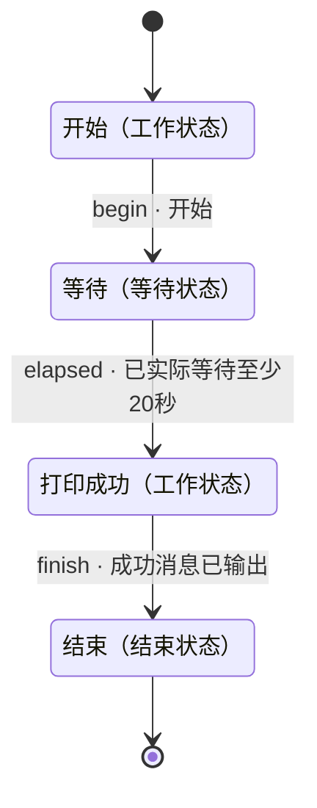

# 等待20秒

- 状态机：`wait20s-example`
- 定义版本：`1.0.0`
- 入口：开始（`start`）

## 用途

> 开始后等待20秒，再打印测试结果并结束。

## 状态机总览

以下为完整状态机定义。连线标注迁移 ID、跳转条件及必要质量项；返工、异常和循环均保留。子状态机内部结束后返回父层级。

## 推进方式

使用自己的 Agent 读取本定义、检查实际证据并维护状态。无需调用 DecoupleFlow 或其他决策服务。

## 使用约定

由宿主 Agent 使用本状态机。节点内如何完成工作由 Agent 自主决定；条件满足后，依据已定义的迁移更新当前状态。

业务材料和工具由宿主管理。未知条件不等于满足条件；工具请求受理不等于任务完成。仅对迁移显式引用的质量项进行该次跳转的必要检查，其余质量项用于改进结果。

子状态机有独立入口；进入子状态机后从内部入口开始，内部结束状态表示返回父状态机，再检查该子状态机节点的出边。记录完整状态路径，避免混淆不同层级。

## 状态一览

| ID | 状态 | 类型 | 所属层级 |
|---|---|---|---|
| `done` | 结束 | 结束状态 | 顶层 |
| `print` | 打印成功 | 工作状态 | 顶层 |
| `start` | 开始 | 工作状态 | 顶层 |
| `wait` | 等待 | 等待状态 | 顶层 |

## 跳转一览

| 跳转 ID | 从 | 到 | 条件 | 路径类型 | 必要质量项 |
|---|---|---|---|---|---|
| `begin` | 开始 | 等待 | 开始 | 正常 | — |
| `elapsed` | 等待 | 打印成功 | 已实际等待至少20秒 | 正常 | — |
| `finish` | 打印成功 | 结束 | 成功消息已输出 | 正常 | — |

## 结束 · done

类型：结束状态

### 状态说明

> 结束当前测试。

### 进入条件

_未填写_

### 质量条件

未单独定义。

结束结果：success。结束当前任务实例。

### 工具调用说明

_未填写_

### 配置说明

_未填写_

### 当前状态的处理策略

_未填写_

### 失败时的处理

_未填写_

### 无法判断时

> 无法判断时保留当前状态，补充信息后再次检查。

### 下个步骤

这是结束状态。

## 打印成功 · print

类型：工作状态

### 状态说明

> 打印“成功进行了skill测试”。

### 进入条件

_未填写_

### 质量条件

未单独定义。

### 工具调用说明

_未填写_

### 配置说明

_未填写_

### 当前状态的处理策略

_未填写_

### 失败时的处理

_未填写_

### 无法判断时

> 无法判断时保留当前状态，补充信息后再次检查。

### 下个步骤

- **结束**（`done`），迁移 `finish`
  - 条件：成功消息已输出
  - 路径类型：正常
  - 必要质量项：无额外引用
  - 不确定时：确认输出结果。

## 开始 · start

类型：工作状态

### 状态说明

> 开始本次测试。

### 进入条件

_未填写_

### 质量条件

未单独定义。

### 工具调用说明

_未填写_

### 配置说明

_未填写_

### 当前状态的处理策略

_未填写_

### 失败时的处理

_未填写_

### 无法判断时

> 无法判断时保留当前状态，补充信息后再次检查。

### 下个步骤

- **等待**（`wait`），迁移 `begin`
  - 条件：开始
  - 路径类型：正常
  - 必要质量项：无额外引用
  - 不确定时：确认用户是否已发起测试。

## 等待 · wait

类型：等待状态

### 状态说明

> 等待20秒

### 进入条件

_未填写_

### 质量条件

未单独定义。

### 工具调用说明

_未填写_

### 配置说明

_未填写_

### 当前状态的处理策略

> 使用宿主能力实际等待。

### 失败时的处理

> 记录未完成的原因。

### 无法判断时

> 核实实际等待时间。

### 下个步骤

- **打印成功**（`print`），迁移 `elapsed`
  - 条件：已实际等待至少20秒
  - 路径类型：正常
  - 必要质量项：无额外引用
  - 不确定时：继续等待并核实时间。
